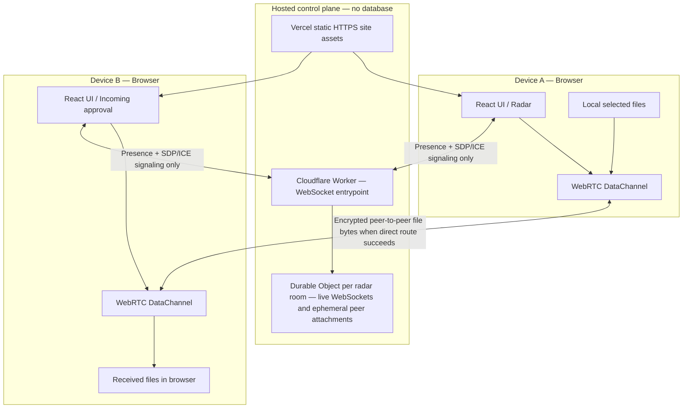
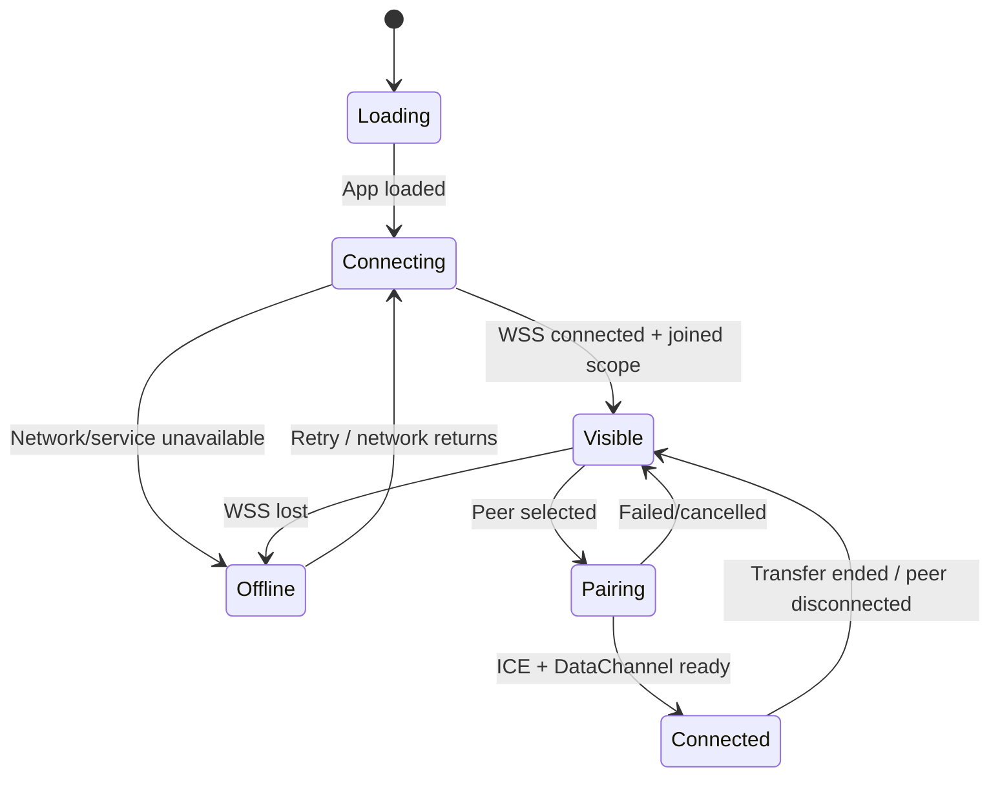

# Zipply — Privacy-First Peer-to-Peer File-Sharing Website

> **Project status:** Personal project implementation blueprint (official product name: Zipply; Vercel + Cloudflare Workers Free; no Render)  
> **Product goal:** A free, accountless, ad-free, privacy-first website for sharing files directly between browsers, with automatic online peer discovery, a radar-inspired UI, and a best-effort offline pairing mode.  
> **Security principle:** Use HTTPS/WSS, WebRTC DTLS encryption, and mandatory independent peer-fingerprint verification so a signaling-layer man-in-the-middle cannot silently intercept a transfer. Fail closed if peer verification is missing or mismatched.
> **Core principle:** The signaling server coordinates discovery and connection setup; it does not receive or store file contents in the normal direct-transfer path. File manifests are exchanged only over a verified peer data channel. Files are transferred without app-level compression or media conversion, preserving the exact original bytes. No web design can guarantee security against every compromised endpoint, browser extension, malicious served JavaScript, or user deception; these residual risks must be documented honestly.

---

## 1. Executive Summary

**Official name: Zipply.** Use `Zipply` as the product name in documentation and UI; use `zipply` for the repository slug, package namespace, and lower-case technical identifiers where appropriate. Do not use the retired working name in the interface or future docs.

Zipply is a mobile-first, responsive, privacy-first peer-to-peer file-sharing website. The UI follows the attached `bryl-minimal-design.skill`, including its monochrome radar, typography-led hierarchy, restrained halftone accents, and light/dark/system themes. It must support portrait and landscape layouts on phones/tablets as well as desktop. The first release should prioritize reliable file transfer, privacy, accessibility, and a small critical JavaScript payload over visual effects.

Zipply is a website inspired by simple device-to-device sharing apps. A user opens the site, enters or accepts a temporary display name, and is automatically shown other discoverable Zipply sessions as soon as the signaling connection is ready. The user selects a peer, requests a transfer, and the receiver approves it. Photos, videos, documents, archives, audio, code files, and other file types can be transferred as their original bytes. The application must never resize images, re-encode videos, change resolution, alter metadata, or recompress a file during transfer.

The project has two connection modes:

1. **Online Radar (primary):** The website connects to a small signaling service over a secure WebSocket. The service keeps active peer presence in memory and informs users about other peers in the same discovery scope. WebRTC attempts a direct encrypted data connection between the browsers.
2. **Offline Pairing (fallback):** If the website has already been loaded and cached, users can attempt a local peer connection by exchanging WebRTC connection details through copy/paste and, where practical, QR codes. This is a fallback, not automatic local-network discovery.

### Important technical boundary

A browser-only website **cannot reliably enumerate or automatically discover every other device on an arbitrary Wi-Fi/LAN**, especially with no internet and no pre-existing local service. Browsers restrict low-level network discovery for security reasons. Therefore:

- When online, Zipply can automatically discover other Zipply users who are connected to the same configured radar scope through its signaling service.
- That does **not** mean the website knows that these users are physically nearby or on the same Wi-Fi.
- When fully offline, cached website assets can still load, but automatic discovery is not guaranteed. QR/manual exchange can establish a connection only when the devices have a workable local route and their browsers support the required behavior.
- True automatic offline LAN discovery would require a local companion service/native app, or a supported browser capability beyond the baseline web platform. That is outside the website-only MVP.

The radar is a **visual peer-discovery interface**, not a measurement of physical distance. Do not display fake meters, proximity scores, or signal strength.

---

## 2. Requirements and Product Rules

### Must have

- No user accounts, email addresses, passwords, or permanent profiles.
- No application database or Redis/shared state store in the MVP.
- No ads, trackers, analytics scripts, or telemetry by default.
- Mobile-first responsive UI that works in portrait and landscape on mobile, tablet, laptop, and desktop; no horizontal overflow at supported viewports and no loss of transfer state on orientation changes.
- UI/UX built against the attached `bryl-minimal-design.skill`, including accessible peer-list alternatives to the radar and explicit Accept, Reject, and Cancel controls.
- Accessibility target: WCAG 2.2 AA practices, keyboard operation, visible focus, readable contrast, screen-reader announcements, and reduced-motion support.
- Performance treated as a release requirement: small initial payload, lazy-loaded secondary features, no third-party trackers/fonts/scripts, and repeatable mobile/desktop Lighthouse and PageSpeed Insights checks.
- PageSpeed Insights API monitoring through GitHub Actions after production deployment and on a daily schedule, with mobile and desktop reports saved as workflow artifacts and summarized in the job output.
- Free to use; publish all application code in a public GitHub repository.
- Automatic peer discovery as soon as the website connects to the online signaling service.
- Temporary display names and short-lived, random session identifiers.
- Radar UI, peer list, transfer requests, and clear connection status.
- QR/copy-paste pairing fallback.
- Support arbitrary file types; don't block a file merely because of its extension or MIME type. Treat all transferred files as untrusted.
- Transfer exact original bytes only: no lossy compression, video transcoding, image resizing, or format conversion. Verify received bytes before reporting success.
- Transfer multiple selected files sequentially in the MVP.
- Progress, speed, cancellation, failure, completion, integrity status, and automatic resume after a transient connection interruption.
- Receiver approval before file bytes are accepted; receiver can reject a pending request or cancel an accepted/in-progress transfer.
- Resume from the last receiver-confirmed checkpoint instead of restarting from byte zero, provided both browser sessions remain available and the receiver's partial data remains intact.
- File contents and file manifests do not pass through the signaling service in the normal direct-transfer mode; the initial signaling request contains no filenames, sizes, or MIME types.
- HTTPS/WSS only in production, strict signaling origin validation, and no fallback to insecure transport.
- Mandatory peer-authentication step using a locally calculated short authentication string (SAS) derived from both WebRTC DTLS SHA-256 fingerprints and fresh session nonces. Users must compare the same verification phrase using an independent trusted channel or in person. A mismatch, unavailable fingerprint, or skipped verification blocks file metadata and file bytes.
- Receiver approval before file bytes are sent, after the verified channel displays the file manifest; receiver can reject a pending transfer or cancel an accepted/in-progress transfer.
- Minimal metadata disclosure, no third-party analytics/scripts/fonts by default, no unnecessary signaling logs, and explicit disclosure that direct WebRTC can reveal network-address metadata.
- A cached offline app shell after first successful load, where the browser allows it.
- Clear explanations when network/browser restrictions prevent a connection.

### Non-goals for the MVP

- Cloud file storage or shareable file links hosted by Zipply.
- User accounts, contacts, permanent history, or synchronized identities.
- Guaranteed transfers across every firewall, VPN, hotspot, or enterprise network.
- Guaranteed unlimited file sizes. File type support is broad, but practical file size depends on device memory, browser APIs, local temporary storage quota, and connection quality. Target 10 GB transfers on tested supported browsers; do not claim that every browser/device can receive 10 GB.
- Guaranteed resume after a tab/browser is closed, a device restarts, or local temporary storage is evicted. The MVP guarantees best-effort automatic resume for transient network/connection loss while both transfer pages remain open; cross-reload recovery is an explicitly tested enhancement.
- Measuring real-world distance or discovering every device on a LAN from a normal browser.
- Mandatory TURN relay infrastructure in the first release.
- Group broadcasts or simultaneous multi-peer transfers.

---

## 3. Recommended System Architecture

### Recommended stack

| Layer | Technology | Why this choice |
|---|---|---|
| Web UI | **TypeScript + React + Vite** | Strong browser API support, component-based UI, quick development, type checking, fast development and production bundling. |
| Styling | **Tailwind CSS** | Fast, consistent responsive UI development. |
| Signaling / presence | **TypeScript on Cloudflare Workers + Durable Objects** | Serverless, WebSocket-capable coordination with WebSocket Hibernation for long-lived presence. The application will not call the Durable Object SQL/storage APIs; it uses only transient live-connection state and per-connection metadata. |
| Peer connection | **WebRTC `RTCPeerConnection` + `RTCDataChannel`** | Browser-native DTLS-encrypted peer data transport. Encryption alone is not enough to authenticate the intended peer against a malicious signaling service. |
| Peer authenticity / MITM defense | **Mandatory short authentication string (SAS) verification** | Each client independently computes a verification phrase from the negotiated DTLS SHA-256 fingerprints, fresh nonces, protocol/version context, and connection transcript. Both users must compare it over an independent trusted channel before any file manifest or bytes are allowed. |
| Connection discovery/routing | **ICE + STUN** | Lets browsers attempt direct connections through common NAT/network setups. Direct connectivity is not guaranteed; STUN services can observe connection metadata. |
| Offline shell | **Service Worker + Cache API** | Caches static site assets so the interface can reopen after a successful first load. |
| Pairing | QR code + copy/paste | Provides a human-controlled way to exchange offer/answer information when signaling is unavailable. |
| File integrity | Web Crypto API, SHA-256 | Can detect corruption or incomplete reconstruction by comparing hashes. |
| Persistent storage | **No application database or file storage** | Online presence is tied to live WebSocket connections and ephemeral connection attachments used only to recover presence after hibernation. No SQL/KV/storage API or app records are used. |
| Deployment | **Vercel Hobby for the static website + Cloudflare Workers Free for signaling** | Vercel serves static frontend assets; a Worker routes each room to a Durable Object that coordinates active WebSocket peers without an application database. Both have free plans with quotas. |

**Why TypeScript on Cloudflare Workers?** It keeps the client and signaling code in one language, deploys to a free edge runtime, and pairs with Durable Objects for consistent per-room WebSocket coordination. WebRTC—not the backend language—carries the actual file bytes. Use the WebSocket Hibernation API and live-connection attachments so active presence can be reconstructed after hibernation without writing application records to a database. Keep the Workers account on the Free plan; enforce quotas and degrade gracefully rather than enabling paid usage.

### High-level architecture



The signaling service can see WebSocket connections and the signaling messages it routes. Network infrastructure necessarily handles connection metadata. Zipply must not log file contents and must never accept file chunks as ordinary upload requests. **Security gate:** no file manifest or file bytes may be sent until both users locally confirm that their displayed SAS words match through an independent trusted channel. The SAS is computed in the browser from the WebRTC fingerprint transcript; it is never generated or vouched for by Cloudflare. HTTPS/WSS protects signaling in transit, while SAS comparison is the independent check that detects a malicious signaling intermediary that tries to terminate two separate WebRTC connections. Vercel serves only the static frontend; Cloudflare Workers accepts signaling connections and routes each room to one Durable Object. Do not use Worker global variables as authoritative shared presence because Worker isolates can be evicted or scaled independently. Use Durable Objects only as real-time coordinators, with no calls to SQL or persistent storage APIs. Cloudflare Durable Objects support WebSocket Hibernation, which lets connected peers remain connected while the object sleeps; transient peer metadata is associated with live sockets and is discarded when those sockets close.

### Runtime components

1. **React client:** display name, visibility state, radar, peer list, pairing, file picker, incoming request, transfer queue, progress, and errors.
2. **Presence manager:** opens one WSS connection, joins the chosen discovery scope, sends heartbeat messages, handles reconnects, and updates the peer list.
3. **Signaling server:** validates messages and routes offers, answers, ICE candidates, and cancellation messages between active sessions.
4. **WebRTC manager:** creates an `RTCPeerConnection`, performs ICE negotiation, and opens a data channel.
5. **Transfer protocol:** sends file manifests and chunks with backpressure, acknowledgements, cancellation, and final integrity verification.
6. **Offline pairing module:** exports/imports a peer offer or answer as text and QR where it fits; never assumes QR capacity is unlimited.
7. **Service worker:** caches only the static application shell and explicitly approved assets. It does not cache private file contents or session messages.

---

## 4. Automatic Discovery Design

### Online discovery: target experience

The user's requested behavior is: **open the website → become discoverable → see other active peers as quickly as practical**.

The web client should:

1. Load the UI and show a small `Connecting to radar…` state.
2. Generate a cryptographically random temporary session ID using `crypto.getRandomValues`; do not use the display name as an identifier.
3. Connect to the signaling service over `wss://`.
4. Send a `hello` message containing protocol version, session ID, sanitized temporary display name, and requested visibility mode.
5. Join the configured public radar scope (or a private invite scope if chosen).
6. Receive a snapshot of active discoverable peers, then incremental join/leave/presence events.
7. Show peers as soon as valid events arrive; do not wait for all peers to load before rendering.
8. Send heartbeat messages on an interval and expire peers whose leases lapse. The server must also clean up on WebSocket close.
9. Retry with exponential backoff and jitter after connection loss. Show offline state instead of fabricating peers.

### What “automatic” means

Automatic discovery can be fast **within the same signaling scope**. It is not geographic discovery. If every user joins one global public radar, a peer could be on another continent. The product must call these “available peers” or label the radar as a shared online lobby—not promise physical proximity.

### Scope and privacy recommendation

To satisfy automatic discovery without accounts:

- When the website opens, it may connect to the radar and show currently discoverable peers as quickly as possible. **Being able to see the radar and being publicly visible are separate controls.**
- Default the user to `Invisible` until they explicitly switch `Discoverable` on or join a room. Explain that turning it on exposes their temporary display name and online presence to participants in that scope. This is the privacy-first default; do not silently broadcast presence globally.
- Provide an immediate `Visible / Invisible` toggle and a `Disconnect` action.
- Support private rooms by high-entropy, short-lived invite code for safer sharing. Do not place secret room capabilities in URL query strings or server logs.
- Do not show IP addresses, precise locations, browser/device fingerprints, email addresses, or stable device IDs.
- Display names are labels, not verified identities. Two users can choose the same name. Peer fingerprint verification is mandatory regardless of display name.
- Rate-limit public discovery, incoming connection requests, and repeated failed verifications.

The public radar is not a private network: it must be clearly labeled as a shared online scope. If the user wants maximum privacy, use a private room/invite code and turn visibility off after the transfer.

### Discovery state machine



---

## 5. Connection and Transfer Flow

### Online direct transfer — privacy-first order

1. Sender selects a peer and selects files locally. File names, sizes, MIME hints, and file contents remain in the sender browser; they are not sent to the signaling service.
2. Sender clicks **Request connection**. The signaling service forwards only a random one-time request ID, a target peer ID, a short expiry, and the minimum non-sensitive protocol fields needed to route the request. The receiver can accept or reject this connection request without seeing a file manifest yet.
3. If accepted, peers exchange WebRTC offer/answer and ICE candidates through WSS signaling, then attempt a direct ICE route. The signaling service necessarily sees SDP/ICE signaling data and connection metadata; do not log those payloads.
4. When the `RTCDataChannel` opens, each browser computes the SAS locally from the WebRTC DTLS SHA-256 fingerprint pair, fresh nonces, and canonical connection transcript. Both users must compare the displayed words using an independent trusted channel or in person. **Do not send the SAS through the same signaling channel and treat that as verification.** If words do not match, verification is unavailable, or either side declines, close the peer connection and send no manifest or file bytes.
5. Only after the local checks pass on both endpoints, send a small `peer-verification-approved` control message over the data channel bound to the current transcript. This message is not a replacement for each user's local comparison and cannot enable a bypass.
6. The sender sends the file manifest over the verified encrypted data channel—not through signaling. The receiver sees filenames, individual sizes, total size, and MIME hints, then explicitly clicks **Accept files** or **Reject files**. Filenames can contain sensitive information, so keep them out of room snapshots, provider-visible signaling messages, and logs.
7. Only after file acceptance does the sender stream file slices in chunks, using `bufferedAmount` / `bufferedAmountLowThreshold` to apply backpressure.
8. Receiver validates transfer ID, chunk sequence, declared size, and configured transfer limits. It assembles data progressively where supported.
9. The receiver sends cumulative acknowledgements only after bytes have been accepted by the active receiving sink. The sender tracks confirmed bytes separately from bytes queued to WebRTC.
10. If the data channel drops, pause at the last receiver-confirmed checkpoint and reconnect when possible. If a new WebRTC/DTLS connection is negotiated, repeat peer-fingerprint/SAS verification before sending new file bytes or resuming payload transfer.
11. After reconnection and successful continuity/authentication checks, negotiate the last confirmed offset. Resend only the unconfirmed tail; do not restart from zero.
12. After the final byte, the receiver verifies expected size and SHA-256 integrity, closes/commits the receiving sink, and then reports completion. Both clients release transient resources when complete or canceled.

### Offline/local pairing

A service worker can cache the UI after the first successful visit. If the Internet disappears, the UI may still load, but the online signaling service is unavailable. For this reason, v1 offline pairing uses manually exchanged WebRTC connection descriptions:

1. Device A generates an offer and displays export text/QR.
2. Device B imports/scans the offer and generates an answer.
3. Device B shares the answer back to A.
4. Both clients add the exchanged ICE information and attempt a direct route.
5. If connection succeeds, transfer uses the same file-transfer protocol as online mode.

WebRTC offer/answer payloads and candidate strings can be too large for one QR code. Implement copy/paste first; add multi-part QR only after testing. Manual signaling may fail on certain networks or browser versions. Do not claim offline pairing works on every device.

### TURN relay policy

For MVP, use direct WebRTC paths with STUN configuration and report connection failure honestly. Some corporate, campus, VPN, mobile, or restrictive NAT networks may require a TURN relay. A later optional TURN service can improve success rates, but adds hosting cost and means file bytes may traverse a relay server. If TURN is added, describe the route accurately and set retention/logging policies accordingly. Do not call a relayed transfer strictly direct device-to-device.

---

## 6. File Transfer Protocol

> **Performance note:** WebRTC is the browser-compatible MVP transport. Zipply will target the fastest reliable transfer it can achieve in supported browsers, but it must benchmark rather than promise native QUIC/Iroh multi-gigabit rates. See Section 43 for the benchmark plan and reference-derived enhancements.

### File-type support

Accept any user-selected file format. Treat MIME type and extension as display hints, not proof of safety. Zipply transports bytes; it does not execute files. The receiver should be responsible for choosing whether to save/open the result.

### Chunking, throughput optimization, and flow control

- Use `File.slice()` to read a file in bounded chunks rather than `await file.arrayBuffer()` for the entire file.
- Use **64 KiB as a safe initial chunk-size baseline only**, not a permanent performance limit. Benchmark 16, 32, 64, 128, and 256 KiB (and other values only when supported by measured results) across the supported browsers and devices. Respect the negotiated WebRTC/SCTP `maxMessageSize`; never assume every browser supports the same maximum.
- After stable baseline measurements exist, implement bounded adaptive chunk sizing if benchmarks show a meaningful benefit. Adapt only within validated limits and lower the chunk size if the receiver falls behind, memory pressure rises, or the channel reports sustained buffering. Avoid tuning based on a single noisy sample.
- Use `RTCDataChannel.bufferedAmount` and `bufferedAmountLowThreshold` to throttle the sender and avoid unbounded buffering. Make the high/low watermarks configurable for benchmarking; stop enqueueing at the high watermark and resume only when the buffer drains below the low watermark.
- Keep the MVP's **file scheduling sequential** for correctness, resume, and predictable memory use. Benchmark optional bounded concurrency/interleaving later; enable it only if it measurably improves end-to-end throughput on representative devices without harming mobile stability or fairness.
- Prefer a direct ICE connection. Do not introduce a TURN relay into the direct-only MVP silently; if a relay is added later, show that the route is relayed because speed, privacy properties, and operating costs can differ.
- Do not compress, resize, transcode, or convert original file bytes. Media files are transferred exactly as selected; this protects original quality and avoids compression CPU overhead. Do not claim this makes every transfer faster—the connection and device remain the main performance factors.
- Include transfer ID, file index, chunk index, byte offset, byte length, and final-chunk indication in the protocol.
- Validate that chunks arrive at the expected offset and do not exceed declared size or configured limits. Avoid copying large buffers unnecessarily and keep binary data out of React state.
- Support pause/cancel locally; disconnect and cleanup must release timers, references, and buffers.
- Treat a lost data channel as a temporary interruption, not automatic cancellation. Retain the latest receiver-confirmed checkpoint, re-establish signaling/WebRTC when connectivity returns, authenticate the same transfer, and continue from that offset. Never restart a resumable transfer from byte zero unless verification fails or the user explicitly starts over. See Sections 35–36 for the required resume protocol and limitations.

### Transfer-speed benchmark and optimization acceptance criteria

- Build a repeatable benchmark harness using generated test files (for example 100 MiB, 1 GiB, and 10 GiB where the browser and device can safely support them). Test both many-small-file sets and a single large file.
- Test direct local-network and internet connections separately, and record whether each route is direct or relayed. Record browser/version, operating system, device class, network type, source/received bytes, wall-clock duration, median sustained throughput, reconnect behavior, and peak memory where measurable.
- Benchmark chunk sizes and buffer watermarks against the same scenario. Select defaults from repeatable results, not intuition. Keep test runs long enough to identify throughput degradation after warm-up and under mobile memory pressure.
- Acceptance: a transfer must remain bounded-memory, preserve all original bytes, show accurate progress, and recover from interruption. Performance tests should detect major regressions against the checked-in baseline; do not promise a universal Mbps figure because networks and devices vary.
- The UI should show current speed and a rolling average, along with an estimated remaining time only when enough measurements exist. Smooth or label noisy estimates rather than displaying misleading precision.

### Large-file constraint

“Any file type” is realistic; “unlimited file size in every browser” is not. Reconstructing received files as in-memory `Blob` parts can consume significant RAM. A streaming-to-disk API is not available with consistent support in every browser. The MVP should publish tested per-browser file-size guidance and use a configurable limit. Do not promise multi-gigabyte support until it has been measured on target devices.

### Suggested first transfer limits

- Configure a maximum file count and per-transfer byte limit on both sides.
- Detect File System Access API and Origin Private File System (OPFS) support and estimate local storage capacity before accepting very large files. Use a bounded-memory streaming/staging path where supported; do not assemble 10 GB in a single in-memory Blob.
- Enforce limits before acceptance and again while receiving.
- Display exact size and a warning for large transfers, including when the current browser does not have a suitable resumable receiving path.
- Never silently drop, truncate, or report success for an incomplete file. If local storage/quota or browser support is inadequate, reject before transfer with a clear explanation.

---

## 7. Signaling Protocol (Initial Version)

Use JSON messages over WSS for signaling only. Define a `protocolVersion` and reject unsupported versions cleanly.

### Client → server message types

- `hello`: join radar with a temporary ID, display name, visibility, and protocol version.
- `heartbeat`: renew presence lease.
- `leave`: voluntarily stop being discoverable.
- `connection-request`: ask a peer to begin a verified peer-connection handshake; contains no file metadata.
- `connection-response`: accept or reject a connection request; file acceptance happens later over the verified DataChannel.
- `offer`: WebRTC session description from initiator.
- `answer`: WebRTC session description from receiver.
- `ice-candidate`: ICE candidate to route to the target session.
- `cancel`: cancel a pending connection or transfer request.
- `transfer-cancel`: terminal cancellation for an accepted/in-progress transfer; route the control signal to the paired peer even if its DataChannel has dropped.
- `resume-request` / `resume-response`: request or deny rejoining an existing interrupted transfer after a fresh signaling session. These messages contain no resume secret and no file bytes; peer continuity is verified client-to-client over the newly established encrypted DataChannel.

### Server → client message types

- `hello-accepted`: assigned/confirmed temporary session ID and server config.
- `peer-snapshot`: current discoverable peer list in the chosen scope.
- `peer-joined` / `peer-left`: incremental presence events.
- `connection-request`: incoming request with temporary sender label and expiry only; no manifest.
- `connection-response`: accepted/declined result for connection setup. The manifest and file-level Accept/Reject exchange happen later over the verified DataChannel.
- `offer` / `answer` / `ice-candidate`: targeted signaling payloads.
- `transfer-cancel`, `resume-request`, `resume-response`: targeted transfer control messages needed when a DataChannel is unavailable.
- `error`: safe, structured error code and user-readable description.

### Validation rules

- Validate schema, message type, size, protocol version, and field lengths.
- Sanitize display names for display; still render user-provided strings as text, never raw HTML.
- Route to session IDs, not names.
- Never trust client-declared file sizes; count actual received bytes.
- Rate-limit room joins, transfer requests, signaling messages, and reconnect attempts.
- Enforce scope membership and prevent one client from sending signaling to unrelated sessions.
- Do not write SDP, ICE candidate strings, complete file names, or other unnecessary metadata to routine production logs.

---

## 8. Security and Privacy Requirements

### Baseline controls

- Serve the site only over HTTPS; use WSS for signaling in production.
- Use cryptographically random, short-lived session IDs. A display name must not grant authority.
- Require explicit receiver approval before file transfer starts.
- Add `Visible / Invisible`, disconnect, decline, and cancel controls.
- Show the sender identity label and full file list before acceptance.
- Validate message schemas and cap message sizes.
- Apply per-connection and per-IP rate limits. Explain in the privacy policy that the hosting provider and server necessarily process connection metadata such as IP addresses even if Zipply has no user accounts.
- Disable verbose debug logging in production and avoid analytics/tracking by default.
- Store presence and pending transfer requests in process memory only; expire entries quickly and clear them on disconnect.
- Do not store files on the signaling server. Never create a file-upload endpoint in the signaling API.
- Use a restrictive Content Security Policy and sensible security headers.
- Do not use `dangerouslySetInnerHTML` to display names, filenames, room labels, or error messages.
- Treat transferred files as untrusted user content. Never auto-execute, auto-open, or embed arbitrary received content as active HTML.
- Keep dependencies minimal, pinned, and reviewed; automate dependency and test checks in GitHub Actions.

### Threats to test

- A stranger impersonates a known display name.
- A peer sends repeated transfer requests or oversized signaling messages.
- A malicious peer sends an invalid manifest or chunks larger than the declared file.
- A browser reconnects and leaves duplicate ghost presence entries.
- A user tries to message a session outside their allowed room.
- A file transfer disconnects at the final chunk but is incorrectly marked complete.
- A crafted filename attempts UI injection or path traversal in a downloaded archive.
- Public radar presence reveals that a user is online. Provide an invisible/private mode and a visible disclosure.

### Privacy statement should explain

- What the server sees: connection IP/metadata, temporary session name/ID, room scope, and signaling information needed for connectivity.
- What the server does not store: file contents and permanent profile records.
- Direct route vs relay route: direct transfer is the goal; if a TURN relay is introduced, file traffic can pass through that relay.
- Session lifecycle: temporary presence is deleted on disconnect/timeout and all in-memory presence resets when the service restarts.
- Public visibility: if a global radar is enabled, other users in that scope can see the temporary display name until the user becomes invisible or disconnects.

---

## 9. Repository Layout

```text
zipply/
├── apps/
│   ├── web/
│   │   ├── public/
│   │   │   ├── icons/
│   │   │   └── manifest.webmanifest
│   │   ├── src/
│   │   │   ├── app/
│   │   │   ├── components/
│   │   │   │   ├── Radar/
│   │   │   │   ├── PeerCard/
│   │   │   │   ├── PairingPanel/
│   │   │   │   ├── IncomingRequest/
│   │   │   │   └── TransferQueue/
│   │   │   ├── features/
│   │   │   │   ├── presence/
│   │   │   │   ├── signaling/
│   │   │   │   ├── peer-connection/
│   │   │   │   ├── file-transfer/
│   │   │   │   └── offline-pairing/
│   │   │   ├── services/
│   │   │   ├── hooks/
│   │   │   ├── types/
│   │   │   └── test/
│   │   ├── package.json
│   │   └── vite.config.ts
│   └── signaling/
│       ├── src/
│       │   ├── index.ts
│       │   ├── rooms/RadarRoom.ts
│       │   ├── protocol/
│       │   ├── validation/
│       │   └── presence/
│       ├── test/
│       ├── wrangler.jsonc
│       ├── vitest.config.ts
│       └── package.json
├── docs/
│   ├── ARCHITECTURE.md
│   ├── PROTOCOL.md
│   ├── PRIVACY.md
│   ├── SECURITY.md
│   ├── OFFLINE-MODE.md
│   └── SELF-HOSTING.md
├── tests/
│   ├── e2e/
│   └── fixtures/
├── .github/workflows/
│   ├── web-ci.yml
│   ├── signaling-ci.yml
│   ├── lighthouse-ci.yml
│   └── pagespeed.yml
├── .editorconfig
├── .gitignore
├── LICENSE
├── README.md
└── SECURITY.md
```

Keep frontend and signaling service in one repository (a monorepo) for coordinated protocol changes. Keep the signaling protocol types documented and versioned so future clients can fail safely if incompatible.

---

## 10. User Interface and Experience

### Main screen

- Follow the attached `bryl-minimal-design.skill` as the UI source of truth. Use a strict monochrome palette, true black/white/gray semantic tokens, restrained hairline borders, typography-led hierarchy, and halftone dots. Do not use the earlier navy/cyan/teal/green/amber/red palette; this design skill overrides that earlier direction.
- Render the radar in monochrome: fine concentric hairline rings, a subtle grayscale sweep, small halftone/solid peer points, and contrast/inversion to emphasize the selected peer. Peer placement is decorative, not geographic, distance, or signal strength.
- Ship both light and dark themes from the beginning, with `system` as the default and persisted user selection. Keep the interface mobile-first and provide an accessible peer-list alternative.
- Clear state badge: `Connecting`, `Visible`, `Invisible`, `Offline`, or `Reconnecting`.
- Display name input and random default nickname option.
- Radar with discovered peers plus an accessible list view for screen readers and users who prefer reduced motion.
- A `Scan/Refresh` affordance may retry discovery but must not imply hardware scanning.
- A persistent private room/invite option.
- A visible privacy indicator explaining whether the user is public or private.

### Mobile-first responsive behavior

- Design from the narrowest supported viewport first. Primary target widths: 320, 360, 375, 390, 430, 768, 1024, 1280, and 1440 CSS pixels. Test both portrait and landscape (for example 390×844, 844×390, 360×800, and 800×360).
- Use fluid layouts, `min-width: 0`, responsive grid/flex rules, and deliberate breakpoints. Do not fix the radar or transfer queue to a desktop-only width. The layout must never create accidental horizontal scrolling at supported sizes.
- On phones, use a compact top bar and stack radar, peer list, transfer queue, and privacy/discovery controls vertically. On larger screens, use a sidebar or two-column workspace only when it improves scanning and operation.
- In portrait, keep the radar within the available content width and place the accessible peer list and transfer requests below it. In landscape, reduce radar height and use the wider canvas for peer details/transfer status without clipping controls. Reflow modals into a near-full-screen sheet when height is constrained.
- Respect mobile safe areas with `env(safe-area-inset-*)`; use dynamic/small viewport units (`dvh`/`svh`) carefully for full-screen overlays and avoid fixed controls being hidden by browser chrome or the on-screen keyboard.
- Use at least 44×44 CSS-pixel touch targets where practical for primary actions, with spacing to prevent accidental acceptance/rejection/cancellation. Preserve keyboard access and visible focus on desktop.
- Never use hover as the only way to reveal actions. Avoid relying on radar dot position alone; every peer and state must be available in a semantic list.
- Test 200% and 400% browser zoom where feasible, text enlargement, long display names, long filenames, large file sizes, localization expansion, reduced motion, dark/light/system themes, keyboard-only navigation, and screen-reader announcements.
- An orientation or viewport change must not recreate or reset WebRTC connections, discard transfer state, lose the receiver's pending decision, or trigger a new transfer. Layout changes are presentation-only.

### UI/UX interaction rules

- Use one clear primary action per state. Distinguish `Accept`, `Reject`, `Cancel transfer`, `Disconnect`, `Hide from radar`, and `Resume` as different operations; do not reuse one button for incompatible actions.
- Confirm destructive actions only when data could be lost; keep an obvious way to reject an unaccepted request. After cancellation, stop sending immediately and do not automatically resume that transfer.
- Show concise plain-language status and next steps for connecting, peer verification, incoming request, rejected request, transferring, paused/reconnecting, verifying, completed, and failed states. Never communicate status using color alone.
- Disable unavailable actions with an explanation. Prevent double-submit/race conditions by making each transition idempotent and rendering the server/client state rather than optimistic fake progress.
- Reserve space for progress/status labels to reduce layout shifts. Announce transfer-state changes to assistive technology without announcing every chunk update.
- Use small, purposeful animation only; never animate the entire page or heavy particle/radar effects. Honor `prefers-reduced-motion` and keep the app understandable when animation is disabled.

### Peer card

Show temporary display name, online status, short session label if needed, and an action to request sharing. Do not show fake signal strength or distance. Random radar positions are decorative only and should not encode physical location.

### Incoming transfer dialog

Show sender label, file count, filenames, individual sizes, total bytes, and whether large-file storage requirements are met before any payload bytes are accepted. Provide distinct `Accept` and `Reject` actions. Never auto-accept a new transfer. The dialog must be keyboard accessible, announce itself to assistive technology, and display filenames as text rather than HTML.

### Transfer queue

Show file name, sent/received/confirmed byte count, percentage, speed, last confirmed checkpoint, status, and verification result. The sender can cancel; the receiver can cancel an accepted incoming transfer at any time. A transient disconnection changes the state to `Paused — reconnecting` and keeps resumable data. An explicit user cancellation is terminal and discards the partial file/checkpoint after confirmation where data would be lost. Handle reduced-motion preferences. Avoid rendering filenames as HTML.

---

## 11. Development Roadmap

> Keep the core website-first roadmap small. Additional reference-inspired features are staged in Section 43.6 and must not delay reliable transfers, privacy, receiver consent, resume, and security gates.

### Phase 0 — Project foundations

- Create a public GitHub repository and select a license (MIT is a simple default if it fits the project's goals).
- Add README, architecture notes, security policy, privacy explanation, and CI workflows for the personal project.
- Scaffold React + TypeScript + Vite frontend and a TypeScript Cloudflare Worker with a Durable Object room coordinator.
- Add formatting, linting, type checking, and test commands.
- Define protocol version 1 and shared test fixtures.

**Exit criteria:** A clean clone can run the frontend and signaling service locally using documented commands; CI passes.

### Phase 1 — Direct WebRTC transfer proof of concept

- Make two browser tabs/devices exchange a manually copied offer/answer.
- Open a DataChannel and send a small text payload.
- Implement file manifest and chunked file bytes.
- Add backpressure, cancel, disconnect handling, byte-count validation, and SHA-256 verification.
- Test images, PDFs, ZIPs, mixed file types, empty files, and interrupted transfers.

**Exit criteria:** Receiver's output matches original bytes; large test transfers don't require loading the entire sender file into memory at once.

### Phase 2 — Online signaling and presence

- Implement secure WebSocket endpoint.
- Implement `hello`, peer snapshots, join/leave notifications, heartbeat, and timeouts.
- Keep presence and room membership in transient live-connection state only.
- Add protocol validation, message size limits, room authorization, and rate limits.
- Add offer/answer/ICE routing with no file-data handling.
- Reconnect clients safely without ghost users or duplicate sessions.
- Add a reconnect handshake that re-establishes an interrupted WebRTC connection and resumes an already-approved transfer from its last receiver-confirmed checkpoint.

**Exit criteria:** Two different devices on different networks can discover each other in the same scope and establish a direct connection when network conditions permit.

### Phase 3 — Automatic radar UX

- Auto-connect to WSS on app open.
- Add public/invisible state, room join, peer list, radar animation, and clear online status.
- Explain global scope vs physical proximity in product copy.
- Add user-visible connection and server errors.

**Exit criteria:** A newly opened online client appears to other connected clients after the signaling service accepts its presence; peers disappear after disconnect/timeout.

### Phase 4 — Full transfer UI

- Multiple file selection, manifest preview, explicit receiver approval, sequential queue, progress and speed display.
- Configurable maximum transfer size/count and warning for large transfers.
- Proper file saving behavior in supported browsers, using a bounded-memory receiving strategy for large files.
- Add completion, checksum mismatch, rejection, sender cancellation, receiver cancellation, temporary interruption, reconnecting, and resumed states.
- Implement checkpoint acknowledgements and automatic resume after a transient disconnect while the transfer pages remain open.

**Exit criteria:** A user can transfer multiple files and know whether each is completed, canceled, rejected, or failed.

### Phase 5 — Offline pairing and cached app shell

- Add PWA manifest and service worker to cache static UI assets.
- Add manual export/import of WebRTC offer/answer text.
- Add QR encoding/scanning where payload length and device support permit.
- Add instructions for same-LAN attempts and explain offline limitations.
- Test site reopening with the internet disabled after a successful prior visit.

**Exit criteria:** Cached UI opens offline, and manual pairing succeeds on documented supported browser/network combinations. Do not count offline automatic discovery as an MVP success criterion.

### Phase 6 — Security hardening and cross-browser beta

- Test Chrome, Edge, Firefox, Safari, Android and iOS browsers where practical.
- Test local Wi-Fi, mobile hotspot, separate networks, VPN, and restrictive network failures.
- Test resumable large-file receiving capabilities and explicitly document which browsers support the desired sink and reconnect behavior.
- Audit public radar visibility, rate limiting, session cleanup, untrusted filenames, and signaling authorization.
- Add privacy, threat model, known limitations, self-hosting guide, and release instructions.
- Use GitHub Actions to run all unit and integration tests.

**Exit criteria:** Documented successful and unsupported cases, no known high-severity issue in the MVP, and reproducible deployment.

---

## 12. Testing Strategy

### Unit tests

- Presence expiry and reconnect behavior.
- Message schema validation and size caps.
- Room/scope authorization.
- Transfer manifest and chunk sequence validation.
- Byte counts and checksum verification.
- Checkpoint acknowledgements, resume offset negotiation, idempotent duplicate-chunk handling, and resume-token validation.
- Cleanup after cancellation, errors, or peer disconnect.
- Filename display safety and UI escaping.

### Integration and end-to-end tests

- Two same-browser tabs.
- Two browsers on one device.
- Two devices on the same Wi-Fi.
- Two devices on different networks.
- One device switches networks mid-session.
- Signaling service restarts (all in-memory presence should be lost safely).
- Receiver rejects transfer.
- Sender cancels transfer.
- Transfer interrupted during first, middle, and last chunk; restore network and verify continuation from the last acknowledged checkpoint, not byte zero.
- Simulate signaling/WebSocket loss while a direct DataChannel stays alive; verify transfer continues if the data path remains usable.
- Simulate data-channel closure, reconnect both peers, reconcile the resume offset, and verify the final bytes.
- Ensure unacknowledged tail chunks are resent safely without duplication/corruption.
- Test receiver rejection before transfer, receiver cancellation during transfer, sender cancellation, and cancel-versus-reconnect race conditions.
- Verify canceled transfers do not silently resume and their partial data is cleaned up.
- Large file under the configured limit and attempted file above it.
- Duplicate display names and private room isolation.
- Offline shell after first cache, then offline reload and manual pairing attempt.

### Responsive, usability, and accessibility tests

- Playwright viewport coverage at 320, 360, 375, 390, 430, 768, 1024, 1280, and 1440 CSS pixels, in portrait and landscape for representative mobile/tablet sizes.
- Assert no document-level horizontal overflow (`scrollWidth <= clientWidth` within a small rounding tolerance); assert critical controls remain visible, reachable, and not obscured by safe areas or the keyboard.
- Simulate orientation change during discovery, SAS verification, incoming request, active transfer, paused transfer, and completion; transfer state and connection must remain unchanged.
- Keyboard-only navigation, focus trap/return for dialogs, Escape behavior where safe, accessible names, screen-reader live regions, touch-target checks, color-contrast checks, `prefers-reduced-motion`, and `prefers-color-scheme`.
- Test very long sender/device names, Unicode filenames, multiple files, huge byte counts, empty radar, many peers, small-height landscape, browser zoom, and no-motion mode.
- Run automated accessibility checks (for example axe-core) in CI, but retain manual keyboard/screen-reader review for security dialogs and transfer consent.

### Performance metrics

- Time from page ready to WSS-connected status.
- Time from WSS connection to peer list update.
- Peer list event latency.
- WebRTC connection setup duration (report distributions, not guarantees).
- Transfer throughput and CPU/memory use for different file sizes.
- Recovery time after transient signaling disconnect.
- Memory behavior while sending/receiving the largest supported MVP file.

Do not fabricate performance targets until baseline tests run on real devices and networks. Record hardware, browser, network type, test file size, and whether the route was direct or relayed.

---

## 13. Deployment and Operations

### Frontend

- Build static assets with Vite and deploy `apps/web` to Vercel Hobby over HTTPS.
- Configure `VITE_SIGNALING_URL` to the separate Cloudflare Worker signaling service URL; the production value must use `wss://`.
- Cache versioned static assets in the service worker; handle updates deliberately so old clients do not use incompatible protocols indefinitely.
- Do not cache file content, offers/answers, room lists, or private transfer state in the service worker.

### Signaling service

- Deploy the signaling Worker and Durable Object on the Cloudflare Workers Free plan. Vercel serves the static frontend only.
- Tie peer presence to live WebSocket connections and minimal per-socket attachments; rebuild the peer list from the active sockets when a Durable Object wakes after hibernation.
- On a socket close, delete the peer from the visible roster and remove any associated pending requests. Closed socket attachments disappear.
- Configure connection limits, message size limits, timeouts, origin checks, and per-peer/per-room rate limits.
- Log operational errors without logging file bytes or unnecessary signaling payloads.
- Keep one Durable Object per room, which provides consistent coordination for that room without a separate shared-state service.

### Free-use policy

Zipply is free to users and the hosted demo is designed to stay within Vercel Hobby and Cloudflare Workers Free quotas. Do not enable paid plan upgrades or paid add-ons. Free hosting is quota-limited and not a guarantee of permanent uptime; if a quota is reached, discovery may temporarily fail and should present a clear retry state. Direct file traffic should not consume the application signaling service's bandwidth in the normal peer-to-peer route.

---

## 14. Release Criteria

Before declaring v1 ready, confirm:

- [ ] Public repo has a license, README, architecture diagram, security policy, and privacy explanation.
- [ ] Opening the website attempts WSS discovery automatically and shows truthful state.
- [ ] Users understand the scope of visibility and can become invisible or disconnect.
- [ ] Online presence is ephemeral and server restart clears it.
- [ ] Display names are not treated as identity or authorization.
- [ ] Receiver first approves a connection request, then independently approves/rejects the manifest after the encrypted peer channel is authenticated.
- [ ] A locally generated peer-verification phrase is mandatory; mismatch, missing fingerprint, or skipped verification fails closed before manifest/data transfer.
- [ ] Manifest/file names and sizes are never sent through signaling or written to logs.
- [ ] Adversarial tests prove that a signaling MITM substituting DTLS fingerprints yields mismatched SAS values and zero file bytes sent.
- [ ] File transfer is chunked and uses backpressure.
- [ ] Byte count, chunk sequence, and per-chunk/final integrity are validated before success is shown.
- [ ] Integration tests prove received file bytes are exactly identical to source bytes.
- [ ] No application-level compression, transcoding, resizing, or format conversion exists in the transfer path.
- [ ] No file upload endpoint or permanent file storage exists on the signaling backend.
- [ ] Offline UI cache and manual pairing limitations are documented.
- [ ] Large files are bounded by tested resource limits.
- [ ] Cross-browser limitations and network failures are documented.
- [ ] CI passes and a clean personal development setup is reproducible.

---

### Responsive and performance release gates

- Verify the production build at supported mobile portrait/landscape and desktop viewports with no unintended horizontal scroll, clipped controls, overlay traps, or orientation-induced state loss.
- All core flows—visibility, peer selection, SAS verification, incoming Accept/Reject, cancel, resume, and final hash verification—must be operable on a mobile touch screen and by keyboard.
- Run Lighthouse CI on the built app in CI and PageSpeed Insights API against the deployed public URL. A missing PSI field-data/CrUX record is not a build failure; lab audits must still run.
- Aim for PageSpeed Insights mobile Performance **95+** and desktop **98+**, with Accessibility **100**, Best Practices **95+**, and SEO **95+** where applicable. Treat these as targets, not guarantees. Use a repeatable CI Lighthouse floor of 90 for Performance and 95 for Accessibility/Best Practices/SEO, then address remaining PSI recommendations before release. Do not accept a severe regression just because a single noisy audit happens to pass.
- Core Web Vitals targets, when field data is available: LCP ≤ 2.5 s, INP ≤ 200 ms, and CLS ≤ 0.1 at the 75th percentile. Use lab TBT as a diagnostic proxy, not as a substitute for field INP.
- No unneeded third-party scripts, analytics, remote fonts, marketing pixels, auto-playing video, or large hero imagery. Verify the browser does not download file-transfer chunks to the server during direct transfers.
- All CI, responsive, accessibility, security, integrity, transfer-recovery, and performance checks pass. Publish known browser/network limitations clearly.

## 15. Final Technical Recommendation

Build **Zipply** with **React + TypeScript + Vite** for the website on **Vercel Hobby**, **TypeScript Cloudflare Workers + Durable Objects on the Workers Free plan** for realtime signaling, and **WebRTC DataChannels** for direct file transfer. Do not use an application database, SQL queries, KV, Redis, or persistent application records. Use WebSocket Hibernation and transient live-connection attachments to coordinate current peers. Use a service worker for the cached app shell and manual QR/copy-paste pairing as the offline fallback. Keep both providers on their free plans and handle quota exhaustion without enabling billing.

Most importantly, transfer original bytes without any media processing or application-level compression, verify the receiver output, and make the promise precise:

> **When the website is open and online, Zipply automatically shows other discoverable Zipply sessions in the same radar scope as soon as signaling connects. It attempts encrypted direct transfer between peers. When the internet is unavailable, cached UI and manual local pairing may work, but a browser-only website cannot guarantee automatic discovery of all devices on the local network.**

That promise is technically realistic, privacy-conscious, and achievable as a public personal project without accounts, ads, a database, or server-side file storage.

---

## 16. Reference Documentation

Official technical references used to shape this plan:

- MDN — WebRTC connectivity and signaling: https://developer.mozilla.org/en-US/docs/Web/API/WebRTC_API/Connectivity
- MDN — WebRTC signaling and video calling: https://developer.mozilla.org/en-US/docs/Web/API/WebRTC_API/Signaling_and_video_calling
- MDN — WebRTC protocols, ICE, STUN, and TURN: https://developer.mozilla.org/en-US/docs/Web/API/WebRTC_API/Protocols
- MDN — WebSocket API: https://developer.mozilla.org/en-US/docs/Web/API/WebSocket
- MDN — Service Workers: https://developer.mozilla.org/en-US/docs/Web/API/Service_Worker_API/Using_Service_Workers
- MDN — PWA caching: https://developer.mozilla.org/en-US/docs/Web/Progressive_web_apps/Guides/Caching
- Chrome for Developers — Local Network Access changes: https://developer.chrome.com/blog/local-network-access
- Cloudflare Workers — WebSockets: https://developers.cloudflare.com/durable-objects/best-practices/websockets/
- IETF RFC 8827 — WebRTC Security Architecture (including signaling-service MITM considerations): https://www.rfc-editor.org/rfc/rfc8827.html
- IETF RFC 8826 — WebRTC Security Considerations: https://www.rfc-editor.org/rfc/rfc8826.html

---

## 17. Implementation-Ready Defaults

Use these defaults to keep the first release focused. Change them only when a measured test or clear product requirement justifies it.

| Setting | Initial default | Notes |
|---|---|---|
| Presence mode | Radar connection starts automatically; self-visibility defaults to Invisible until explicitly enabled | Discovery may show opted-in peers, but the user's own temporary name is not broadcast until the user chooses Discoverable. Provide an immediate Invisible/Disconnect control. |
| Presence heartbeat | 20 seconds | Tune after testing mobile browser suspension and server load. |
| Presence expiry | 60 seconds without a valid heartbeat | Remove immediately on clean WebSocket close; expiry handles crashes and lost connections. |
| Discovery scope | Shared online radar for users who opted in, plus private invite rooms | Public scope is not geographic proximity. Use private rooms for safer transfers. |
| Signaling transport | WSS in production; WS on localhost only for local development | Never send session tokens or signaling over an untrusted production connection. |
| WebRTC data channel | Ordered, reliable channel | File delivery must preserve byte order and detect incomplete transfers. |
| Initial chunk size | 64 KiB | Benchmark before changing. Respect data-channel buffering and browser memory constraints. |
| Transfer concurrency | One active file at a time per transfer | Simpler resource handling and progress reporting for v1. |
| Relay policy | Direct ICE connection first; no required TURN service in v1 | Clearly display connection failure when relay support would be needed. |
| File persistence on server | Never | The signaling server must not accept file upload requests or write file data to disk. |
| Client-side transfer history | Current page session only | Do not persist filenames or transfer records by default. |
| Analytics | Disabled | No advertising scripts or trackers. Operational server logs should be minimal and disclosed. |

These are engineering starting points, not universal performance guarantees. Verify timeouts and transfer limits on real phones, laptops, browsers, and networks before describing them as supported limits.

## 18. Local Development Setup

Use a supported current LTS version of Node.js and npm, plus Wrangler for local Cloudflare Worker development. Pin tool versions in project documentation and CI after the first successful setup. The commands below use PowerShell on Windows; they can be adapted to Bash or zsh.

### Prerequisites

- Git
- Node.js and npm
- Wrangler CLI (installed as a project dev dependency)
- A Chromium-based browser and Firefox for the first test pass
- Two browser contexts for early transfer tests; two physical devices for later LAN tests

### Create the workspace

```powershell
mkdir zipply
cd zipply
git init

mkdir apps
npm.cmd create vite@latest apps/web -- --template react-ts
cd apps/web
npm.cmd install
cd ../..

mkdir apps/signaling
cd apps/signaling
npm.cmd init -y
npm.cmd install --save-dev wrangler typescript vitest @cloudflare/vitest-pool-workers
cd ../..
```

Create `apps/signaling/src/index.ts`, `apps/signaling/src/rooms/RadarRoom.ts`, `apps/signaling/wrangler.jsonc`, and a Worker test configuration. Pin npm dependencies with `package-lock.json`. Use Cloudflare Workers and Durable Objects official documentation as the implementation reference: https://developers.cloudflare.com/durable-objects/best-practices/websockets/.

Install frontend dependencies deliberately rather than adding a large toolkit by default. Add Tailwind, a QR library, test runner, and end-to-end browser tooling in separate commits so dependency changes are easy to review.

### Initial developer commands

Add root-level scripts or a `Makefile`/PowerShell helper later. For the first scaffold, run the two applications in separate terminals:

```powershell
# Terminal 1: frontend
cd apps/web
npm.cmd run dev
```

```powershell
# Terminal 2: Cloudflare Worker / Durable Object
cd apps/signaling
npx wrangler dev
```

The first implementation task should create a minimal health endpoint, a WebSocket upgrade route, and a per-room Durable Object before building radar visuals. The Vite dev server and Wrangler dev server are separate local processes. In production, deploy the static frontend to Vercel and the signaling Worker plus Durable Object to Cloudflare Workers Free.

## 19. Configuration and Environment Variables

Do not hardcode deployment URLs, credentials, room secrets, or ICE server configuration in source files.

Suggested frontend build-time configuration:

```dotenv
# apps/web/.env.example
VITE_SIGNALING_URL=ws://localhost:8787/ws
VITE_APP_NAME=Zipply
VITE_PROTOCOL_VERSION=1
```

Use `ws://` only for localhost development. Production must use `wss://`. Never commit a real `.env` file containing secrets. Values prefixed with `VITE_` are exposed to the browser; they are configuration, not secrets.

Suggested signaling service configuration:

```dotenv
# apps/signaling/.dev.vars.example
ALLOWED_ORIGINS=http://localhost:5173
PUBLIC_RADAR_ENABLED=true
PRESENCE_HEARTBEAT_SECONDS=25
PRESENCE_TTL_SECONDS=75
MAX_WS_MESSAGE_BYTES=65536
MAX_PENDING_REQUESTS_PER_SESSION=10
```

This is a proposed configuration contract. Implement and validate each setting before documenting it as active. The Vercel production build should set `VITE_SIGNALING_URL` to the Cloudflare Worker WebSocket URL; preview builds must not silently share the public production radar unless intended. Production `ALLOWED_ORIGINS` must list the exact Vercel production origin and explicitly approved test origins, not `*`. Set deployment variables in Cloudflare Worker settings or Wrangler environment configuration. Do not place secrets in `VITE_` variables because they are public build-time values.

## 20. Concrete Signaling Message Contracts

Use one JSON envelope for all WebSocket control messages. Keep the schema versioned and strictly validate every input. Do not pass file chunks through these messages.

### Common envelope

```json
{
  "version": 1,
  "type": "heartbeat",
  "requestId": "optional-random-id",
  "payload": {}
}
```

The server must assign the canonical `peerId` after a connection is accepted. A client-generated session ID can be used as a diagnostic nonce, but must not grant authority or determine which peer receives messages. A `peerId` is temporary, unpredictable, bound to one live socket, and invalidated on disconnect/expiry.

### `hello`

```json
{
  "version": 1,
  "type": "hello",
  "payload": {
    "displayName": "Alex's Laptop",
    "visibility": "public",
    "roomCode": null
  }
}
```

The server validates the name, limits its length, assigns the `peerId`, and joins the selected scope. If `visibility` is `private`, a valid invite capability must be provided. Do not let a client select another peer's ID or join a private scope merely by guessing its name.

### `hello-accepted` and `peer-snapshot`

```json
{
  "version": 1,
  "type": "hello-accepted",
  "payload": {
    "peerId": "server-assigned-temporary-id",
    "scopeId": "temporary-scope-id",
    "heartbeatSeconds": 20,
    "presenceTtlSeconds": 60
  }
}
```

```json
{
  "version": 1,
  "type": "peer-snapshot",
  "payload": {
    "peers": [
      {
        "peerId": "temporary-peer-id",
        "displayName": "Alex's Laptop",
        "joinedAt": 0
      }
    ]
  }
}
```

Treat the `joinedAt` field as an optional relative/epoch timestamp only if there is a product reason to show it. Do not add IP address, real location, hardware identifiers, or a persistent device fingerprint to peer snapshots.

### `connection-request` and response

```json
{
  "version": 1,
  "type": "connection-request",
  "payload": {
    "requestId": "random-one-time-id",
    "targetPeerId": "receiver-temporary-id",
    "expiresAt": 0,
    "protocolVersion": 1
  }
}
```

This signaling message deliberately contains no file names, file sizes, MIME types, file counts, previews, manifest hashes, or file bytes. The backend routes it only to the target peer if both sessions are allowed to interact in the selected scope. After WebRTC is established and both users independently verify the SAS, send the file manifest over the encrypted data channel and let the receiver accept/reject it. Validate every manifest field and size on both clients. Do not write the manifest or signaling messages to server logs.

### `offer`, `answer`, and `ice-candidate`

Each message must include a one-time `requestId` or `connectionId`, a `targetPeerId`, and only the WebRTC description/candidate required for negotiation. Validate that the sender is a party to that pending connection before routing. Expire pending negotiations quickly and cap SDP/candidate message lengths.

### Error format

```json
{
  "version": 1,
  "type": "error",
  "payload": {
    "code": "RATE_LIMITED",
    "message": "Too many requests. Try again shortly."
  }
}
```

Use stable machine-readable codes such as `INVALID_MESSAGE`, `UNSUPPORTED_VERSION`, `NOT_VISIBLE`, `PEER_NOT_FOUND`, `REQUEST_EXPIRED`, `RATE_LIMITED`, and `SERVER_BUSY`. Do not send stack traces, filesystem paths, or internal service details to the browser.

## 21. Backend State Model Without a Database

Represent live state in memory with explicit ownership and cleanup rules. Example logical model:

- `PeerSession`: server-assigned `peerId`, WebSocket connection, validated display name, scope ID, visibility, last-heartbeat time, pending request IDs.
- `Scope`: opaque ID, whether public or private, set of active peer IDs, expiry metadata.
- `PendingRequest`: random request ID, sender ID, target ID, request metadata, creation time, expiry time, state.
- `ConnectionNegotiation`: connection ID, initiating peer ID, accepting peer ID, expiry time, ICE/signaling state needed only for validation.

Protect shared maps with a mutex or a concurrency-safe ownership model. Never hold a global lock while blocking on a network write. Use bounded outbound queues and disconnect slow consumers rather than allowing unbounded memory growth.

### Cleanup rules

- Remove peer on WebSocket close.
- Expire a peer after its presence lease elapses, even if the socket appears stuck.
- Remove pending requests when accepted, declined, canceled, disconnected, or expired.
- Remove negotiation state after connection setup timeout or completion.
- Drop empty temporary rooms when no active peer or unexpired invitation requires them.
- Clear all in-memory presence on process restart; clients must reconnect and rejoin.

A single in-memory instance is appropriate for MVP. Multiple service replicas will each have different in-memory views; either keep one instance or deliberately introduce a shared ephemeral coordination component later. Do not assume load balancing alone synchronizes presence.

## 22. Frontend State and Component Contracts

Prefer explicit state machines over many loosely related booleans.

### App discovery states

- `starting`: client initializes configuration and creates a temporary name.
- `connecting`: WSS connection in progress.
- `visible`: joined a discovery scope and receiving presence.
- `invisible`: connected but not listed to other peers.
- `offline`: signaling is unavailable; online radar is not live.
- `reconnecting`: retrying after a temporary connection loss.

### Peer connection states

- `idle`
- `requesting`
- `waiting-for-approval`
- `negotiating`
- `connecting`
- `connected`
- `failed`
- `closed`

### Transfer states

- `draft`
- `awaiting-approval`
- `accepted`
- `transferring`
- `verifying`
- `completed`
- `rejected`
- `canceled`
- `paused` (temporary connection loss; resumable)
- `resuming` (reconnecting and reconciling offsets)
- `awaiting-resume-approval` (identity continuity could not be verified)
- `interrupted` (resume no longer possible without user action)
- `failed`

The UI must never treat a WebSocket-connected state as proof that a WebRTC data channel is connected. Likewise, 100% of sender bytes queued does not mean that the receiver has verified the file.

### Components

- `AppShell`: page layout, route/state boundaries, global status.
- `RadarView`: visual representation of currently discoverable peers; derive it from live state, not generated fake peers.
- `PeerList`: accessible non-radar alternative with the same data.
- `VisibilityControl`: visible/invisible toggle and privacy explanation.
- `PairingPanel`: offer/answer export/import, QR mode, manual fallback.
- `TransferRequestDialog`: sender label, filenames, per-file size, total size, storage suitability, accept/reject.
- `IncomingTransferControls`: cancel pending request, cancel accepted transfer, and approve/reject a resume request if peer continuity cannot be verified.
- `TransferQueue`: status, progress, speed, confirmed checkpoint, automatic resume status, sender/receiver cancel, and retry guidance.
- `ConnectionBanner`: explain whether the client is online, local-only, reconnecting, or unavailable.

Honor `prefers-reduced-motion`, keyboard navigation, focus management, sufficient color contrast, and screen-reader announcements for incoming requests and transfer state changes.

## 23. Transfer Framing and Backpressure Algorithm

The sender must avoid loading entire large files or unbounded chunks into the browser's outgoing buffer.

### Sender outline

1. Wait for the data channel to reach `open`.
2. Send a versioned JSON manifest containing file metadata and protocol options.
3. Wait for receiver readiness before starting the first file.
4. Read each file with `File.slice(offset, offset + chunkSize)`.
5. Before each send, check `RTCDataChannel.bufferedAmount`. If it exceeds the high-water mark, wait for `bufferedamountlow` or abort if the connection closes.
6. Send binary chunk frames with unambiguous file/chunk ordering. Either use a documented binary header or a separate JSON frame followed by binary bytes; whichever is chosen, specify it in `docs/PROTOCOL.md` and test malformed sequences.
7. Update progress from confirmed protocol events; distinguish bytes queued locally from bytes acknowledged by the receiver.
8. When all chunks for a file have been sent, wait for receiver confirmation before starting the next file.
9. On finish, wait for receiver byte-count/integrity result. Only then mark the received file verified.

### Receiver outline

1. Reject data before the request is approved.
2. Validate manifest shape, file count, aggregate size, and configured limit.
3. Validate every frame's file ID, chunk index, declared length, and expected order.
4. Count actual bytes and abort if incoming data exceeds the manifest or policy cap.
5. Apply a memory-aware receiving strategy and show a warning where the browser must assemble an in-memory `Blob`.
6. Calculate integrity only after receiving all bytes, when the selected browser implementation can do so within memory/time limits.
7. Ask the user to save the file; do not execute or auto-open it.
8. Release chunks, object URLs, timers, and references when the transfer ends or fails.

`RTCDataChannel.bufferedAmount`, `bufferedAmountLowThreshold`, and the `bufferedamountlow` event are intended mechanisms for this form of flow control. Reference: https://developer.mozilla.org/en-US/docs/Web/API/RTCDataChannel/bufferedAmount and https://developer.mozilla.org/en-US/docs/Web/API/RTCDataChannel/bufferedAmountLowThreshold.

### Integrity note

SHA-256 matching detects an accidental mismatch between the sender's and receiver's calculated bytes, assuming the hashes are exchanged correctly. It does not prove who created a file, whether the file's content is truthful, or whether a user-provided timestamp is authentic.

## 24. Offline Pairing Decision and Fallback UX

Keep the fallback flow honest and easy to understand:

1. If WSS is connected, use online signaling automatically.
2. If WSS becomes unavailable, switch the status to `Offline — radar unavailable` and offer `Try local pairing`.
3. Generate an offer and gather ICE candidates before exporting the offer where manual signaling requires a complete candidate set. Apply a timeout so the user isn't stuck waiting forever.
4. Offer copyable text as the primary fallback; QR is an optional convenience and may require a multi-frame implementation for long payloads.
5. The receiver imports/scans the offer, gathers its answer candidates, and returns the answer.
6. Attempt the peer connection. If it fails, explain that browser privacy settings, mDNS host candidates, router isolation, VPN settings, or the local route may prevent direct connectivity.
7. Do not repeatedly retry invisibly or imply that the website is scanning the entire network.

A cached site can render its UI while offline, but it cannot reach a remote signaling service without connectivity. A local WebRTC connection may succeed only when browsers expose usable candidates and the LAN permits peer traffic. Treat offline pairing as a compatibility-tested best-effort capability until real-device tests establish its support matrix.

## 25. Implementation Backlog: Small Reviewable Tasks

Work in small, reviewable implementation steps. Do not ask an AI coding assistant to implement the whole repository in one large change.

### Milestone A — scaffold and contract

- [ ] Create monorepo folders and initial README.
- [ ] Add license, `SECURITY.md`, and `.editorconfig`.
- [ ] Scaffold React + TypeScript + Vite.
- [ ] Scaffold the TypeScript Cloudflare Worker with `/healthz` and `/ws` WebSocket upgrade route.
- [ ] Add the room Durable Object using the WebSocket Hibernation API.
- [ ] Define message envelope/types and protocol version 1.
- [ ] Add frontend unit tests and Cloudflare Worker/Durable Object tests to CI.

### Milestone B — direct-transfer experiment

- [ ] Add manual offer/answer panel for two browser tabs.
- [ ] Create the WebRTC connection and ordered DataChannel.
- [ ] Send/receive a small text message.
- [ ] Send one small binary file.
- [ ] Add chunking and flow control.
- [ ] Add transfer manifest and explicit receiver approval.
- [ ] Add disconnect/error handling and SHA-256 verification.
- [ ] Document browsers tested and observed maximum stable test size.

### Milestone C — online presence

- [ ] Implement server-assigned peer IDs and validated display names.
- [ ] Implement public scope join and `peer-snapshot`.
- [ ] Implement presence broadcast and leave events.
- [ ] Implement heartbeat lease and timeout cleanup.
- [ ] Add invisible state and private room capability.
- [ ] Implement transfer request/response and guarded signaling relay.
- [ ] Add abuse controls and per-message validation.
- [ ] Test reconnect and server restart behavior.

### Milestone D — user experience

- [ ] Build real-state radar and accessible peer list.
- [ ] Add transfer request and incoming approval dialog.
- [ ] Add file selection, queue, speed/progress, and cancellation.
- [ ] Add useful states for connecting, failed, offline, and invisible.
- [ ] Add mobile-responsive and reduced-motion behavior.

### Milestone E — offline + release

- [ ] Cache the static app shell with a service worker.
- [ ] Add manual offer/answer import/export.
- [ ] Add QR support only after testing payload length and scanning behavior.
- [ ] Run the browser/network matrix.
- [ ] Add self-hosting deployment guide and real privacy disclosure.
- [ ] Tag v0.1.0 only after release checklist passes.

## 26. Personal Project Engineering Guardrails

This repository is maintained by one project owner and is public for transparency, portfolio value, and reuse.

- Make one small, testable change at a time.
- Before accepting AI-generated code into the main branch, inspect the diff, understand the data flow, and run the relevant tests and security checks.
- Never include production secrets, real personal data, actual users' filenames, live connection descriptions, or private ICE candidate dumps in test fixtures.
- Do not change protocol fields without updating `docs/PROTOCOL.md` and protocol tests.
- Avoid new runtime dependencies unless the need is clear and the package is maintained.
- Do not add accounts, databases, analytics, tracking, or server-side file storage.
- Do not claim physical proximity based on radar placement, lossless compression when no compression is used, universal offline discovery, or guaranteed direct connectivity.
- Run the full local test suite before merging changes into the primary branch. GitHub Actions should independently repeat the automated checks on pushes.

## 27. Release Documentation Template

Every public release should include:

- Version and date.
- What changed.
- Tested browsers and operating systems.
- Largest successfully tested file size and relevant device/network details.
- Whether each test used direct connectivity or a relay (if one is ever introduced).
- Known issues and unsupported network conditions.
- Security fixes, if any, without exposing exploit details that users could use before upgrading.
- Upgrade/self-hosting notes.

## 28. Updated External References

- Cloudflare Workers WebSocket Hibernation: https://developers.cloudflare.com/durable-objects/best-practices/websockets/
- Cloudflare Durable Objects pricing and Free plan quotas: https://developers.cloudflare.com/workers/platform/pricing/
- MDN `RTCDataChannel.bufferedAmount`: https://developer.mozilla.org/en-US/docs/Web/API/RTCDataChannel/bufferedAmount
- MDN `RTCDataChannel.bufferedAmountLowThreshold`: https://developer.mozilla.org/en-US/docs/Web/API/RTCDataChannel/bufferedAmountLowThreshold
- MDN `RTCDataChannel` API: https://developer.mozilla.org/en-US/docs/Web/API/RTCDataChannel

Recheck dependencies and browser compatibility before each public release. These references are implementation documentation, not a promise that all APIs behave identically in every browser.


## 29. Free-Only Hosting Architecture: Vercel + Cloudflare Workers

### Chosen deployment layout

- **Vercel Hobby:** deploy `apps/web` as a static Vite website over HTTPS. It serves only frontend assets.
- **Cloudflare Workers Free:** deploy the TypeScript signaling Worker and a Durable Object class for per-room live presence and WebSocket coordination.
- **No Render, no paid servers, no app database, no Redis, no KV, and no R2.** The signaling runtime must not write session records or use Durable Object SQL/storage APIs.
- **Transient peer state:** use the WebSocket Hibernation API and connection-scoped attachments for currently connected peer metadata. Rebuild peer lists from active sockets after hibernation. Closing a socket removes that peer; no history is retained.
- **No automatic upgrades to paid services.** Keep both providers on free plans and display an understandable error if an included quota is exhausted.

### Why not Vercel alone?

Vercel is great for the static UI, but instance-local memory is not reliable shared state for a global realtime radar. Vercel's official WebSocket documentation says connections may land on separate Function instances and advises an external shared coordination mechanism for state across connections. A Vercel-only implementation with no shared store could show inconsistent peer lists. Keep Vercel for the UI and use Cloudflare Durable Objects to coordinate WebSockets for each room.

### Why Cloudflare Durable Objects?

Durable Objects can coordinate multiple WebSocket clients per room. Their WebSocket Hibernation API lets clients remain connected while an object sleeps, reducing duration usage; when the object wakes, app memory has been reset, so peer data must be rebuilt from active sockets and their connection attachments. The attachments are tied to live sockets and are discarded when connections close. Zipply must not call the Durable Object SQL or persistent key/value storage APIs; the object is a realtime coordinator, not an application database.

Important nuance: Cloudflare's Free plan currently permits SQLite-backed Durable Object classes, but Zipply will not create tables or make SQL/storage calls. It uses the runtime and live WebSocket connections only. The hosting provider can revise platform internals and quotas, so recheck current terms before deployment.

### Vercel project settings

- Root Directory: `apps/web`.
- Framework preset: Vite.
- Build command: `npm run build`.
- Output directory: `dist`.
- Environment variable: `VITE_SIGNALING_URL=wss://<your-worker>.<your-subdomain>.workers.dev/ws` for Production. `VITE_` variables are public build-time settings, never secrets.
- Keep the frontend static; do not route file data through Vercel Functions.
- Avoid analytics and tracking scripts.
- Use a restrictive Content Security Policy and allow only the exact signaling Worker hostname in `connect-src`.
- Do not trust preview deployment origins by default. Use a staging radar scope or allowlist only the exact test origin.

### Cloudflare Worker setup

- Keep signaling code in `apps/signaling` using TypeScript.
- Configure the Worker, Durable Object binding, and migration in `wrangler.jsonc`.
- The Worker validates the path, room code, Origin, protocol version, and initial hello message before joining a room's Durable Object.
- The Durable Object coordinates only its own room. For a public radar, one public room is a natural initial scope; private room IDs should be random and non-guessable.
- Use WebSocket Hibernation and minimal connection attachments containing only temporary peer ID, sanitized display name, room visibility, and protocol version. Rebuild presence from active sockets after hibernation.
- Never use `state.storage.sql`, `state.storage.get/put/delete`, Cloudflare KV, D1, Redis, R2, or file-upload endpoints in this project.
- Implement strict message validation, size and rate limits, origin checks, session-bound authorization, and clean peer expiry.

### Free-tier quota and resilience

Cloudflare currently documents a Free allowance of 100,000 Durable Object requests per day and 13,000 GB-seconds of compute duration per day. Incoming WebSocket messages count toward requests using Cloudflare's documented 20:1 adjustment, and WebSocket Hibernation avoids duration charges while eligible objects are asleep. These quotas are finite and can change. Avoid overly frequent heartbeats, batch presence updates, and disconnect stale clients.

On Vercel Hobby, stay within the documented static asset and deployment quotas. On Cloudflare, stay on Workers Free and do not activate paid services. When any quota is reached, operations may fail until reset; show `Discovery temporarily unavailable` and preserve the user's ability to retry or use manual pairing. Do not promise 100% uptime, unlimited users, or forever-free hosting.

### Official references

- Vercel Hobby plan: https://vercel.com/docs/plans
- Vercel platform limits: https://vercel.com/docs/limits
- Cloudflare Workers and Durable Objects pricing: https://developers.cloudflare.com/workers/platform/pricing/
- Durable Objects WebSocket Hibernation: https://developers.cloudflare.com/durable-objects/best-practices/websockets/
- Durable Object lifecycle: https://developers.cloudflare.com/durable-objects/concepts/durable-object-lifecycle/

### What “free” means

Zipply has no user fees, advertisements, subscriptions, or paid features; the hosted demo uses only the Vercel Hobby and Cloudflare Workers Free plans. This does not mean infinite traffic or guaranteed availability. Third-party providers can change free-tier limits or have outages. Zipply should fail safely when limits are reached and must not automatically upgrade to a paid tier. Direct peer transfers normally avoid application-server file bandwidth, but each user's ISP/mobile provider still carries the bytes.

## 30. Original-Byte Transfer: No Compression, No Quality Loss

### Default rule

**Zipply must transfer files byte-for-byte and must not compress, transcode, resize, optimize, or otherwise modify user files.** This means:

- A 4K video remains the same file with the same codec, resolution, bitrate, audio, metadata, and container bytes.
- An image remains the exact original image file; do not resize it or convert PNG/JPEG/WebP/HEIC formats.
- Documents, archives, code files, and unknown binary formats are sent as binary bytes without interpretation.
- Do not create video thumbnails, image previews, or metadata reports by modifying the transfer payload. Any preview must be local-only and separate from the selected file.
- Do not apply application-level compression in the MVP. Lossless compression often offers little or no reduction for already-compressed media (such as JPEG images and common video formats), while lossy transcoding would break the exact-original guarantee.

WebRTC transports the binary messages over an encrypted data channel. Chunk framing and transport encryption are not media conversion: the receiver reconstructs the original byte sequence. If the implementation later introduces optional compression, it must never be enabled for original-file transfers by default and must have an explicit separate output path. The MVP should simply avoid compression altogether.

### Integrity design

- Read each source file with `File.slice()`; never load a full 4K video or large file into memory merely to send it.
- Send chunks in order with file ID, chunk index, exact byte length, and transfer ID.
- Compute SHA-256 for each bounded chunk, and validate each chunk at the receiver, or use a reviewed incremental SHA-256 implementation if a whole-file hash is needed without buffering the entire file.
- Verify the exact total byte count and final chunk count before showing completion.
- On any hash mismatch, missing chunk, duplicate sequence, or unexpected extra bytes, mark the file as failed and do not display success.
- Integration tests must compare the final reconstructed `Uint8Array` bytes to the original bytes exactly, not only compare filenames, file size, resolution, or MIME type.
- Use binary fixtures with arbitrary values, null bytes, Unicode filenames, zero-byte files, large files, and media samples. Store only safe redistributable fixtures in the repository.

WebRTC DataChannels are encrypted in transit, and are designed to carry arbitrary data. References: https://developer.mozilla.org/en-US/docs/Web/API/WebRTC_API/Using_data_channels and https://webrtc.github.io/samples/src/content/datachannel/filetransfer/.

## 31. Security-First Automated Test Plan

Security must be verified by adversarial tests, not only normal success-path tests. No test suite can prove that every vulnerability is absent; the goal is to cover the defined threat model, automate regressions, and document the limits.

### Frontend unit tests

Use Vitest and React Testing Library for deterministic UI/state tests:

- Visibility indicator matches the actual server presence state; disconnect/invisible transitions remove the peer from the published list.
- Display names, room labels, filenames, MIME hints, and error messages are rendered as text, not interpreted as HTML.
- Unicode, long names, right-to-left text, control characters, bidi-control characters, and strings resembling HTML/script payloads cannot alter UI behavior.
- Transfer-state machine rejects illegal transitions (for example, `completed` before verification or `accepted` before receiver approval).
- Cancellation, rejection, timeout, peer disconnect, checksum mismatch, and network loss produce the correct UI state and clean up timers/object URLs.
- The UI shows accurate byte counts and never treats “sent/queued” as “received and verified.”
- Transfer-state machine supports paused/resuming and forbids `completed` before full integrity verification.
- Peer-verification state cannot be skipped via buttons, keyboard interactions, messages, URL parameters, or restored UI state; a mismatch always fails closed.
- Receiver can accept/reject a connection request, accept/reject the file manifest after SAS verification, cancel an active transfer, and review a resume request if peer continuity is uncertain.
- Reduced-motion preference removes or reduces the monochrome radar sweep without hiding peer state.
- The receiver sees sender label, filenames, total size, estimated storage needs, and accept/reject controls before file chunks are accepted.

### Cloudflare Worker / Durable Object unit tests

Use Vitest with `@cloudflare/vitest-pool-workers` and the Workers test environment. Cover:

- Message parser rejects malformed JSON, unknown types, unsupported protocol versions, invalid types, missing fields, negative sizes, integer overflow, and oversized messages.
- Display-name validation and length limits are enforced.
- Server-assigned peer IDs are random and bound to a live socket; a client cannot select or impersonate another peer ID.
- Room membership is checked for every `connection-request`, `connection-response`, `offer`, `answer`, ICE candidate, and signaling cancellation message. Transfer manifests and file-level accept/reject controls are handled only on the verified DataChannel.
- Private invite capabilities are unguessable, expire, and cannot be reused after invalidation where single-use semantics are expected.
- Expired requests and negotiations cannot be revived by replaying old messages.
- Rate limits and connection caps behave correctly under repeated calls.
- Disconnect, heartbeat expiry, shutdown, and reconnect clean up each peer and pending request exactly once.
- Slow outbound clients cannot cause unbounded queue growth or block all other peers.
- Concurrent joins, leaves, messages, timeouts, and cleanup do not create duplicate peers, stale presence, cross-room message delivery, or inconsistent transfer authorization.
- No handler accepts file chunks or writes file data to disk.

### File protocol and integrity tests

- Zero-byte file, one-byte file, exact chunk boundary, boundary + 1 byte, final short chunk, multiple files, and arbitrary binary bytes.
- Missing, duplicated, reordered, truncated, oversized, and unexpected chunks are rejected.
- Manifest size and actual byte count mismatch is rejected.
- Chunk SHA-256 mismatch is rejected.
- Final bytes match the source exactly for image, video, ZIP, PDF, text, and random binary fixtures.
- File transfer never invokes media encoders, image resize, MIME-based rewriting, or compression routines.
- Very large files are handled only within the explicitly configured limit; an over-limit file is rejected before transfer starts and again during receive.
- Backpressure logic stops sending when the outbound buffered amount crosses its high-water mark and resumes only when the buffer drains.

### WebSocket and abuse/security tests

- Reject an unapproved `Origin` header during WebSocket handshake. Origin checking is especially important because there is no login/session-based user identity.
- Reject cross-room/cross-scope signals and attempts to target arbitrary session IDs.
- Reject `hello` and control messages before a valid initial handshake.
- Reject oversized frames, malformed JSON, deeply nested/ambiguous payloads, and unknown schema fields where strict schemas are used.
- Test message floods, connection floods, repeated room creation, repeated transfer requests, repeated renegotiation, and slow consumers against configured rate/size limits.
- Test that reconnecting clients cannot inherit a previous user's identity or pending request.
- Test expired room codes, guessed room codes, replayed offers, stale ICE candidates, and use of another peer's transfer ID.
- Test that public visibility is disclosed and can be disabled; no IP address, physical location, browser fingerprint, or permanent device ID appears in peer snapshots.
- Verify logs do not contain file bytes, complete sensitive payloads, room capabilities, or unnecessary SDP/ICE values.
- Verify there is no file-upload API endpoint and no persistent file storage path.

### End-to-end/browser tests

Use Playwright for a controlled pair of browser contexts and real-device manual tests for browser/network behavior. Apply the mandatory MITM/SAS-specific cases in Section 38.7 before release:

- Open two clients; both appear in radar when the signaling service is connected.
- Select a peer, request a transfer, reject once, then accept a second request.
- Transfer byte-for-byte fixtures and verify saved file hashes.
- Cancel at the beginning, middle, and end; disconnect either side; restart the signaling process; verify no false success or ghost presence remains.
- Test duplicate display names, public and private scopes, browser refresh, sleep/resume, and WebSocket reconnect.
- Test over one Wi-Fi, phone hotspot, and separate networks where available.
- Test cached app-shell reload with the internet off and exercise manual local pairing on documented supported combinations.
- Test Chrome, Edge, Firefox, Safari, Android, and iOS where practical. Document differences instead of assuming identical browser APIs.

### Performance/resource tests

- Simulate several dozen signaling-only clients locally to exercise presence broadcasts, connection cleanup, and message limits.
- Measure memory during the largest supported transfer using representative phones and laptops.
- Verify chunked transfer does not read an entire large sender file into memory before starting.
- Record browser version, OS, network, file size, file hash, duration, and connection route for benchmark runs.
- Do not publish “unlimited files,” guaranteed throughput, or unsupported file-size claims from a single laptop test.

## 32. Automated Security and Quality Tooling

Run checks automatically on every push to the primary branch and allow manual re-runs.

### Frontend checks

- `npm ci` using the committed lockfile.
- `npm run lint` (ESLint with TypeScript and React rules).
- `npm run typecheck` (TypeScript compiler with no emit).
- `npm run test -- --run` (Vitest unit/component tests).
- `npm run build` (production build).
- `npm audit --audit-level=high` or an equivalent dependency-vulnerability check; review results and don't blindly auto-upgrade major versions.

### Cloudflare Worker / TypeScript checks

- `npm ci` using the committed lockfile.
- `npx tsc --noEmit` for strict type checking.
- `npx vitest run` including the Cloudflare Workers test pool.
- Run Wrangler local validation and deployment dry-run before publishing.
- Run `npm audit --audit-level=high`; review dependency findings and update intentionally.
- Add property-based or fuzz-style tests for JSON/message parsing, display-name normalization, room routing, manifests, and chunk framing.
- Test Durable Object hibernation and rehydration of peer metadata from active WebSocket attachments. Verify that closed sockets disappear and no closed-session metadata is retained.
- Use a JavaScript/TypeScript static-analysis tool and GitHub CodeQL where practical; review all high-severity findings.

### Repository/security checks

- Enable GitHub secret scanning where available, and run a secret scanner such as Gitleaks on commits; never put real secrets in fixtures.
- Use GitHub CodeQL or equivalent static analysis for TypeScript/JavaScript if available for the repository.
- Keep dependency lockfiles committed. Review dependency updates and check their advisories before release.
- Fail CI on type errors, failed tests, build failures, protocol/state consistency regressions, and detected secrets. Security scanner findings should be triaged and documented; don't silently ignore high-severity findings.
- Store test reports as CI artifacts when useful, but never store production session logs or real file samples in CI artifacts.

Example root scripts to define in `apps/web/package.json` (exact commands may vary with chosen lint/test configuration):

```json
{
  "scripts": {
    "dev": "vite",
    "build": "tsc -b && vite build",
    "typecheck": "tsc -b --pretty false",
    "lint": "eslint .",
    "test": "vitest"
  }
}
```

The signaling code should remain small and testable. A suite that passes does not guarantee the application is secure; it is a baseline for regression prevention and threat-model validation.

## 33. Personal Public Repository Policy

- The repository is public for source visibility, reproducibility, learning, and portfolio use. The project is maintained by the owner.
- Keep a license if the intent is to grant public reuse. Public visibility alone does not automatically grant permission to reuse the code; choose a license deliberately.
- Keep `README.md`, `docs/ARCHITECTURE.md`, `docs/PROTOCOL.md`, `docs/PRIVACY.md`, `docs/SECURITY.md`, `docs/OFFLINE-MODE.md`, and `docs/SELF-HOSTING.md` aligned with the implementation.
- Provide the public demo URL and status/limitations in the README when deployed. Do not publish actual secrets, `.env` files, personal file samples, or real user/peer data.
- Use the main branch as the known-good version; run the full automated test suite before publishing a release or merging your own development branches.

## 34. Updated Reference Documentation

- Vercel Hobby plan: https://vercel.com/docs/plans
- Vercel platform limits: https://vercel.com/docs/limits
- Vercel WebSocket support and shared-state caveats: https://vercel.com/kb/guide/do-vercel-serverless-functions-support-websocket-connections
- Cloudflare Workers/Durable Objects Free plan and pricing: https://developers.cloudflare.com/workers/platform/pricing/
- Cloudflare Durable Objects WebSocket Hibernation: https://developers.cloudflare.com/durable-objects/best-practices/websockets/
- Cloudflare Durable Object lifecycle: https://developers.cloudflare.com/durable-objects/concepts/durable-object-lifecycle/
- MDN — WebRTC DataChannels, arbitrary binary transfer, and encryption: https://developer.mozilla.org/en-US/docs/Web/API/WebRTC_API/Using_data_channels
- WebRTC official sample — chunked file transfer: https://webrtc.github.io/samples/src/content/datachannel/filetransfer/
- MDN — Service workers: https://developer.mozilla.org/en-US/docs/Web/API/Service_Worker_API/Using_Service_Workers

Recheck hosting limits, dependency advisories, and browser compatibility before each public release. External provider free tiers can change; do not promise perpetual free hosting.


---

## 35. Resumable Transfers After Internet or Peer-Connection Interruption

### Required user-visible behavior

**For an ordinary network interruption, Zipply must pause and resume from the last receiver-confirmed checkpoint, not restart the file from byte zero.** The sender and receiver must remain open for the guaranteed MVP behavior. If the existing WebRTC DataChannel remains healthy even though the signaling WebSocket temporarily disconnects, the active data transfer may continue; signaling loss alone must not reset the transfer. If the DataChannel fails, Zipply pauses, reconnects the peers when signaling becomes available, and resumes from the acknowledged offset.

This requirement does not imply that a browser can resume after every failure. If a user closes a tab, reloads the page, closes the browser, restarts a device, revokes file access, or the browser evicts local temporary data, recovery may require selecting the source file again and/or re-approving the resume. The MVP must be explicit about these conditions. It must never display `Completed` until the receiver has verified the entire file.

### Resume protocol

1. **Stable transfer identity.** Generate a cryptographically random `transferId` and a `manifestDigest` over a canonical manifest of the selected files, sizes, ordering, protocol version, and transfer parameters. Keep the identity stable during retries; do not derive authority from a display name.
2. **Chunk indexes and offsets.** Each chunk has a `fileId`, monotonically increasing `chunkIndex`, `offset`, `byteLength`, and per-chunk SHA-256. The receiver validates all fields, including that a chunk fits inside the declared size and its expected offset.
3. **Receiver-confirmed progress.** The receiver tracks the highest contiguous byte offset actually accepted by the receiving sink and verified. It sends cumulative `checkpoint-ack` messages after each configured checkpoint interval (for example, every 1 MiB) and at file boundaries. The exact interval is configurable and must be benchmarked.
4. **Separate sent from confirmed.** The sender maintains `queuedOffset`, `sentOffset`, and `confirmedOffset` as separate values. Only `confirmedOffset` is authoritative for resume. WebRTC `bufferedAmount` or a successful `send()` call is not proof that the receiver accepted the bytes into its sink.
5. **Pause without deletion.** On connection loss, pause the sender, stop enqueueing chunks, preserve receiver partial output and the latest verified checkpoint, cancel/retry timers safely, and show `Paused — reconnecting`. Do not clear the partial file merely because the network dropped.
6. **Reconnect.** Reconnect the signaling WebSocket with exponential backoff and jitter, rejoin the discovery scope, and re-negotiate WebRTC when necessary. Keep the current transfer session in memory while both pages remain open.
7. **Peer continuity and authentication.** Use a high-entropy resume capability exchanged only over the already-verified encrypted DataChannel and kept client-side, not forwarded in signaling messages or logged. If both active clients still hold matching continuity proof and the same authenticated DTLS connection remains alive, they may resume the previously approved transfer automatically. If a new WebRTC/DTLS connection is created, repeat mandatory SAS fingerprint verification before sending further file bytes; then validate the resume capability. If continuity cannot be verified (for example, after a page reload or context loss), show the receiver a `Resume request` dialog with sender label, filenames, total size, completed amount, and `Resume` / `Reject` choices. A matching display name is never sufficient proof.
8. **Reconcile offsets.** The receiver reports the last contiguous checkpoint for the matching transfer and file. The sender verifies the transfer and manifest identities, then starts at that exact offset. If bytes were written after the most recent checkpoint but not acknowledged, overwrite/truncate that unconfirmed tail before retrying or safely resend it at the same offsets. Do not append to an unknown current length.
9. **Idempotence.** Repeated chunks with the same transfer/file/index and identical digest may be acknowledged without writing twice. Chunks that conflict with the recorded digest or expected offset are rejected and fail the transfer safely.
10. **Verify completion.** After the final chunk, verify total bytes, expected chunk count, per-chunk hashes, and a final file hash where supported. Commit/close the receiving sink only when the transfer is complete and verified. Return a terminal completion message to the sender.
11. **Bounded retries.** Retry connection setup and resume for a bounded window while the pages remain active. Show `Resume failed — retry` when the retry budget expires. Do not burn CPU or battery in an infinite tight reconnect loop.

### No database requirement

Zipply will not add a server-side database, Redis, durable application records, or cloud file storage. While pages remain open, checkpoints and resume capabilities are held in client memory; partial bytes are held in the selected browser-local receiving sink. Any optional post-reload recovery must use browser-local temporary file storage (for example, OPFS) and a small local manifest, not an application database on the server. It must be feature-detected and quota-checked. Browser-local storage can be cleared or evicted and does not provide a universal persistence guarantee.

### Receiving large files

- Prefer a bounded-memory sink: use a supported File System Access API writable stream for in-session incremental writes, or a browser-local OPFS staging file with incremental writes/checkpoints when resumable staging is supported and quota is sufficient. Never assemble a 10 GB file into a single in-memory `Blob` as the only receive strategy.
- Before `Accept`, estimate the transfer size and check the selected receive method and available local storage where possible. `navigator.storage.estimate()` is advisory, not a hard guarantee; quota can still change during a transfer.
- If OPFS staging is used, the data stays on that device and is not uploaded to Zipply's servers. Define cleanup/expiry for abandoned partial files and let the user explicitly resume or delete them.
- If the chosen browser has no safe supported sink for the proposed file size, warn and reject the transfer before bytes begin rather than risking tab crashes or silent corruption.
- On supported desktop Chromium browsers, test the File System Access API path. Test Firefox and Safari separately; do not assume all browsers provide identical APIs.

### Recovery boundary table

| Event | Expected behavior |
|---|---|
| Signaling WebSocket drops, DataChannel still works | Continue transfer if the data channel remains healthy; recover radar independently. |
| Internet/data path drops briefly; both pages remain open | Pause, reconnect as possible, and resume from the last receiver-confirmed checkpoint. |
| WebRTC DataChannel closes; signaling returns | Recreate peer connection, verify transfer continuity, reconcile offset, and resume. |
| Both pages remain open but same-peer proof is missing | Prompt receiver to approve/reject resumption; do not trust display name alone. |
| Sender page reloads/closes | Source `File` references may be lost; ask sender to reselect original files and validate the manifest before resuming. |
| Receiver page reloads/closes | Resume is best-effort only if browser-local partial data and checkpoint survived; otherwise explain that restart is required. |
| User presses `Cancel` | Cancel is terminal: notify the peer, close transfer resources, delete temporary partial data/checkpoints, and do not auto-resume. |
| Receiver presses `Reject` before accepting | No file bytes are accepted; notify sender and expire the request. |
| Hash/offset/manifest mismatch | Stop; do not resume uncertain bytes or report success. Offer restart as a new transfer. |

### Automated tests for resume

- Drop the network after 1%, 50%, and 99% of a multi-chunk file, restore it, and assert that transfer resumes from the most recent acknowledged offset instead of zero.
- Drop signaling while leaving the WebRTC data channel open; verify no duplicate transfer session and no unnecessary restart.
- Close the data channel, restore signaling, create a fresh peer connection, and resume the same approved transfer.
- Disconnect after the receiver writes chunks but before it sends an acknowledgement; confirm the unacknowledged tail is safely overwritten/re-sent without duplication.
- Send duplicate, out-of-order, truncated, oversized, and digest-mismatched chunks during resume; reject them.
- Attempt a resume using the same display name but a different peer capability; require receiver approval or reject.
- Expire a resume capability; reject it.
- Cancel during reconnect and race cancellation against a late checkpoint acknowledgement; cancellation must remain terminal.
- Simulate insufficient browser-local storage and storage write failures; stop safely and preserve the last valid checkpoint where possible.
- Verify the resumed final file has the exact same byte sequence and SHA-256 as the source.

---

## 36. Incoming Transfer Consent, Rejection, and Cancellation

### State and action rules

| State | Receiver controls | Sender controls | Result |
|---|---|---|---|
| `awaiting-connection-approval` | `Accept connection` or `Reject connection` | `Cancel request` | No manifest or file bytes exist on the receiver yet; signaling contains no file metadata. |
| `connecting` / `verifying-peer` | `Cancel`; compare mandatory SAS phrase | `Cancel` | A missing/mismatched phrase closes the connection. No manifest or file bytes are allowed. |
| `awaiting-file-approval` | `Accept files` or `Reject files` | `Cancel request` | Sender delivers the manifest over the authenticated DataChannel only after SAS verification. No file chunks flow until the receiver accepts. |
| `transferring` | `Cancel transfer` | `Cancel transfer` | Either side may cancel immediately. Notify the peer and stop sending/receiving. |
| `paused` / `resuming` | `Resume` / `Reject resume` if continuity isn't verified; `Cancel transfer` always available | `Cancel transfer` | Same authenticated connection may resume; a newly negotiated DTLS connection requires fresh SAS verification before more file bytes. |
| `verifying-file` | `Cancel` only while verification/commit remains abortable | `Cancel` request | Do not claim success until verification and commit complete. |
| `completed`, `rejected`, `canceled`, `failed` | No active transfer controls | No active transfer controls | Terminal state; a new attempt uses a new connection/transfer ID. |

### Required behavior

- The receiver first sees only a temporary sender label and a connection request. Accepting this is not consent to receive files. The receiver sees file names, individual sizes, total size, estimated storage requirement, and browser limitations only after the peer-verification step has succeeded and the sender sends the manifest on the encrypted DataChannel.
- `Reject connection`, `Reject files`, and `Cancel transfer` are distinct controls. Reject connection prevents a session; Reject files refuses the manifest; Cancel stops an accepted or active transfer. All receiver controls must remain available and clearly labeled.
- No file manifest is sent before successful SAS verification, and no file chunks are accepted until the receiver explicitly accepts the manifest. The sender can cancel a pending request at any time.
- When a receiver cancels, send an authenticated `transfer-cancel` control message over the DataChannel if available and over signaling as a fallback, stop accepting new chunks, abort/close the receiving sink safely, and remove temporary data/checkpoints after confirming cancellation. If cleanup fails, surface the retained temporary item for explicit cleanup; never resume it silently.
- When the sender cancels, the receiver gets an immediate state update and the same cleanup rules apply.
- Repeated cancel/reject messages are idempotent. A delayed `accept`, `checkpoint-ack`, or `complete` message cannot move a terminal canceled/rejected transfer back into an active or completed state.
- The receiver can cancel while waiting for connection, during a large file, while paused, during reconnection, or before final commit. If completion already committed and verified, it is completed; the UI must not pretend it can undo the saved file.
- Use explicit copy and labels. Avoid a single ambiguous `X` icon without accessible text/tooltip. Use keyboard-accessible controls and confirm only when cancellation would discard meaningful partial progress.

### Tests

- Receiver rejects the initial connection request; assert no file manifest or file bytes are sent and sender receives `connection-rejected`.
- Connection is accepted but SAS is not confirmed or mismatches; assert no manifest and zero file bytes are sent.
- SAS succeeds and sender sends a manifest; receiver rejects files; assert no file chunks are sent and sender receives `files-rejected`.
- Receiver accepts the manifest; assert file chunks begin only after the explicit file-acceptance transition completes.
- Receiver cancels during each transfer state; assert both peers stop and terminal state is stable.
- Sender cancels while receiver is accepting, while transfer is active, and while resume negotiation is happening.
- Cancel/reject/accept messages arrive out of order or are duplicated; assert legal state transitions only.
- A malicious peer tries to send a chunk before approval or after cancellation; reject it and close the transfer channel if repeated.
- Test accessible keyboard operation, focus order, and screen-reader announcement for Accept, Reject, Resume, and Cancel.

---

## 37. UI Design System — `bryl-minimal-design`

The attached `bryl-minimal-design.skill` is the visual source of truth for the Zipply interface. The radar concept stays, but the earlier colored radar mockup direction (cyan/teal/green/amber/red) is explicitly superseded by the skill's monochrome design language.

### Design principles

- **Strict monochrome:** no accent colors. Use pure white `#ffffff`, near-black `#0c0c0f`, ink `#0a0a0a` / off-white `#f4f4f5`, and semantic gray tokens. Emphasis comes from inversion, typography, and texture—not colorful status colors.
- **Typography-led hierarchy:** Geist for UI/body; Geist Mono for technical labels, timestamps, tags, and status text; Geist Pixel (Square) for display/page titles and selected stat values; Source Serif 4 only for long-form editorial copy. Use compact sizing (roughly 15px UI text, 13px small text, and 9–11px uppercase tracked micro-labels). Use `font-display: swap` and reliable monospace fallbacks.
- **Light, dark, and system themes:** implement semantic tokens and map them to light/dark themes without changing component hierarchy. Default to system theme. Persist the choice locally. Respect the OS preference and declare supported color schemes.
- **Whitespace and hairlines:** narrow content width for text, generous section spacing, one-pixel gray dividers, restrained fills, and no excess card framing. Keep card radii around 16/12/8/6 px for large/medium/small/input elements.
- **Halftone texture:** use a repeating grid of small monochrome dots, about 1px radius on a ~9px grid, faded with a radial/linear mask. Use it in only one or two focal places, such as a corner of the radar or around a title. Do not wallpaper every screen.
- **Restrained motion:** use short ease-out interactions and a subtle radar sweep/status pulse. Respect `prefers-reduced-motion`; when motion is disabled, all peer status and radar meaning must remain clear.
- **Accessible semantics:** semantic landmarks, high contrast, visible focus, keyboard-operable dialogs, Escape to close safe overlays, accessible names for controls, screen-reader announcements, and no status conveyed by color alone.

### Radar-specific implementation

- Draw 3–4 thin concentric circles and a hairline cross-axis/grid on a monochrome background. Use a monochrome sweep wedge/line with low opacity; keep it subtle.
- Represent actual discoverable peers only. Each peer gets a monochrome dot, concise label, and accessible peer-list entry. Use position for layout decoration only—not distance, signal strength, IP location, or proximity.
- Differentiate state using shape, labels, border, and inversion: e.g. solid dot + `CONNECTED`, outlined point + `AVAILABLE`, outlined double ring + `REQUEST PENDING`, and explicit `OFFLINE` text. Do not fall back to a color-only green/amber/red status system.
- Selected peer: invert the label or use a black/white chip. Do not use a colorful highlight.
- Add a non-animated list mode and make the radar optional for reduced-motion users. Use a `SCAN / DISCOVERY` uppercase monospace micro-label consistent with the design skill.

### Component styling tokens

- Background: `--background`; foreground: `--ink`; text muted: `--gray-500`; tertiary text: at least `--gray-400`; border/divider: `--gray-200`; subtle fill: `--gray-50`.
- Light theme uses white background and black ink; dark theme uses near-black background and off-white ink. Define the remaining gray ramp as CSS variables.
- Buttons: understated, 6–8px radius; primary action is inverted ink/background, secondary action is a simple hairline-bordered control or text action. Status chips use hairline borders and uppercase monospace labels.
- Modals: blurred dim overlay, centered panel around 24rem max width, 16px radius, ~1.75rem padding, fade/scale entrance around 200ms, and reliable Escape/key focus handling.
- Cards: fine gray border, generous radius, very subtle ground shadow in light mode; rely mainly on borders in dark mode. Do not create unnecessary colorful cards.

### Privacy and font loading

Self-host permitted font files in the website's static assets when their licenses and redistribution terms allow it. This avoids unnecessary third-party requests and improves repeat/offline load behavior. If fonts are fetched externally instead, use the correct display-swap behavior and visible fallbacks. Do not add analytics or tracking to support visual polish.

### UI design acceptance tests

- The peer-verification modal follows the attached monochrome design skill: no colored success/warning cues; use clear words such as `VERIFICATION REQUIRED`, `MATCH`, and `MISMATCH`, with accessible icons/borders and high contrast.
- Show the six-word verification phrase locally and explain: compare it with the other person over a separate trusted channel or in person; do not approve a mismatch. There is no `skip verification` or `continue anyway` control.
- If verification fails, show a neutral but prominent security failure message, close the connection, and keep file manifests/file bytes blocked.
- No colored cyan/teal/blue/green/amber/red accent styles exist in the radar UI; statuses remain distinguishable by text/icon/shape and contrast.
- `light`, `dark`, and `system` themes render with the semantic token palette.
- Font fallbacks work when custom fonts cannot load and don't cause layout failure.
- Halftone texture appears in at most one or two deliberate focal regions per view.
- `prefers-reduced-motion` removes sweep/pulse/entrance animations without removing meaning.
- Radar and peer list communicate the same live peer state.
- Receiver request modal presents Accept and Reject; active incoming transfer exposes Cancel; resumable transfer exposes paused/resuming state and appropriate resume approval.
- Keyboard and screen-reader tests cover all transfer controls and modals.


---

## 38. Privacy-First Security Model: MITM Defense, Peer Authentication, and Limits

Privacy is the highest product priority. Zipply must be designed so a network attacker or a malicious signaling intermediary cannot **silently** read or alter file contents by substituting itself as a peer. The project must not claim that man-in-the-middle (MITM) attacks are universally impossible: web apps cannot protect users from every compromised endpoint, malicious JavaScript served by a compromised origin, hostile browser extension, operating-system malware, or a user who approves a deceptive verification step. The release claim must be precise: supported signaling-layer MITM attempts are detected by independent peer verification and cause the transfer to fail closed when users correctly compare the verification phrase.

### 38.1 Threat model

| Threat | Required control | Residual limitation |
|---|---|---|
| Passive network eavesdropper | HTTPS/WSS signaling; WebRTC DTLS-encrypted DataChannel | Network metadata and traffic timing may remain visible. |
| Active network MITM | HTTPS/WSS plus WebRTC fingerprint/SAS verification | Do not proceed if SAS cannot be compared independently. |
| Malicious or compromised signaling service tries to MITM | Each browser calculates its own SAS from the negotiated DTLS fingerprints and fresh nonces; users compare phrases out-of-band; no server-generated `verified=true` flag is trusted | An attacker can still block traffic or cause denial of service. |
| Spoofed display name / fake peer | Server-assigned random live peer ID, room-bound authorization, SAS verification | A name is never proof of real-world identity. |
| Replay of stale SDP, nonce, or resume state | High-entropy one-time request IDs, fresh nonces, short expiry, transcript binding, anti-replay state | New connection negotiations require a fresh SAS. |
| File corruption or malicious chunk injection | Strict protocol framing, per-chunk digest, expected offsets/lengths, final SHA-256 and byte-count verification | Hashes confirm integrity of received bytes, not that a sender's content is safe to open. |
| Malicious file received from a peer | Treat bytes as untrusted; do not execute, auto-open, or parse arbitrary formats on the server | The user can still choose to open a dangerous file outside Zipply. |
| Compromised Vercel deployment or malicious frontend JavaScript | No remote scripts, pinned dependencies, strict CSP, reviewed builds, published release hashes, optional self-hosting | A compromised origin can serve JavaScript that reads selected files or lies about verification. Browser-only code cannot defend fully against the code itself being malicious. |
| Peer or STUN provider learns IP/network metadata | Minimal signaling, no IP display in UI, clear disclosure; optional relay-only routing if a separately managed TURN relay is ever available | Direct P2P commonly reveals public candidate/IP metadata to the peer; STUN providers see source/network metadata. A relay can shift trust to the relay operator and may not be free. |
| Abuse, spam, or presence scraping | Default own presence to Invisible, explicit Discoverable toggle, short-lived private rooms, rate limits, request throttles, no stable ID | An opted-in public radar still exposes presence and temporary name within that scope. |

### 38.2 Transport encryption is not enough by itself

WebRTC DataChannels use DTLS-based encryption, but the SDP offer/answer and DTLS certificate fingerprints are delivered through a separate signaling channel. The WebRTC security architecture warns that HTTPS alone does not remove every threat from a malicious calling/signaling service; independent endpoint verification is required when the service is not fully trusted. See [RFC 8827 — WebRTC Security Architecture, communications security](https://www.rfc-editor.org/rfc/rfc8827.html) and [RFC 8826 — WebRTC Security Considerations](https://www.rfc-editor.org/rfc/rfc8826.html).

Zipply therefore requires both:

1. **Transport security:** production site on HTTPS, signaling on WSS, normal browser WebRTC DTLS protections, secure random values, strict origin validation, and no insecure fallback.
2. **Endpoint authenticity:** mandatory SAS verification built from the peers' DTLS SHA-256 fingerprints and fresh handshake nonces. A server may relay signaling, but it must not be able to assert that a peer was verified.

Do not implement custom encryption, custom key exchange, or a homemade cryptographic protocol for the file bytes in the MVP. Use the browser's WebRTC cryptography and standard Web Crypto hash/random APIs, and concentrate custom code on the independently verified transcript and strict state machine. Any future application-layer E2EE feature must be separately threat-modeled and independently reviewed rather than improvised.

### 38.3 Mandatory short authentication string (SAS) protocol

**Transfer payload and file manifests are blocked until peer verification succeeds.** The SAS step is mandatory in privacy-first mode and must not offer `Skip`, `Trust this name`, or `Continue anyway`.

1. Each peer creates fresh cryptographically random nonces with `crypto.getRandomValues()`. Use at least 128 bits of randomness per nonce and bind them to the current request/connection.
2. After SDP negotiation, each browser parses the negotiated WebRTC DTLS `sha-256` fingerprint(s) from its local and remote descriptions. Reject malformed or missing fingerprints; do not accept an unknown protocol version or a downgrade to a weaker verification scheme.
3. Construct a canonical, role-ordered transcript containing the protocol label/version (for domain separation), request/connection ID, offerer nonce, answerer nonce, offerer DTLS fingerprint(s), answerer DTLS fingerprint(s), and the current connection challenge. Normalize fingerprint formatting first and sort multiple fingerprints deterministically. Do not include display names as trusted identity.
4. Hash this transcript with SHA-256 via Web Crypto. Convert a fixed, documented number of digest bits into a **six-word verification phrase** using a reviewed, fixed word list of at least 2,048 entries (approximately 66 bits when using six 11-bit word indexes). Pin the word-list dependency or include its licensed source. The same correctly negotiated two endpoint fingerprints and nonce transcript must produce the same phrase at both peers.
5. Show the phrase independently on each client. Users must compare all words through an independent trusted channel (for example, in person, or a separate trusted voice call). Do not compare by sending the phrase through the same Zipply signaling connection, because a MITM can control that channel. For devices beside each other, the user may visually compare both screens. A QR used merely over the same signaling path is not an independent authentication channel.
6. The user must click an accessible `The words match` control locally. A mismatch has a `Mismatch — cancel connection` action. No file manifest, filename, file size, or file chunk is sent before this local confirmation.
7. After local confirmation, each peer sends a small confirmation over the current DataChannel bound to the transcript digest. This message synchronizes state only; it does not replace local comparison and cannot set another peer's local confirmation flag. Only after both local decisions and the protocol confirmations are present can the receiver view the manifest over the DataChannel.
8. If the phrases differ, the fingerprint is missing/ambiguous, the comparison is not done, the transcript changes, a nonce is reused, or the user cancels, close the current peer connection and purge ephemeral handshake state. Do not retry the same transcript. A retry generates new nonces and a new connection ID.
9. On every new `RTCPeerConnection` / new DTLS association, reconnecting clients must perform a new SAS check before additional file bytes are transmitted. If the existing DataChannel remains alive through a temporary signaling WebSocket outage, do not restart the data channel or needlessly repeat authentication; keep using the original verified association.
10. The browser derives the SAS locally. The Worker/Durable Object never sends a SAS or `verified=true` assertion and never decides that users have authenticated each other.

**Important interpretation:** the phrase proves that the two participants are looking at the same negotiated DTLS endpoint pair for that session, assuming users compare it correctly over an independent channel. It does not identify a person's legal name or protect against a compromised endpoint or malicious JavaScript. With no account or identity provider, there is no persistent real-world identity; verify every new connection.

### 38.4 Signaling and metadata minimization

- Use `wss://` in production and `https://` for the site. Reject plaintext signaling outside `localhost` development. Apply exact production `Origin` allowlists and validate the expected WebSocket upgrade path.
- The Worker may see peer session IDs, temporary display names, room/scope identifiers, online presence, SDP fingerprints, and ICE candidates. Treat SDP/ICE as sensitive network metadata. Never log full SDP, ICE candidates, room capabilities, SAS transcript inputs, or resume tokens.
- The initial `connection-request` must not carry filenames, sizes, total bytes, MIME types, file counts, thumbnails, or manifest hashes. Only send the manifest on the authenticated DataChannel, after SAS verification. File names are metadata too and may expose private facts.
- Do not put secret room codes or resume capabilities in query strings, analytics, referrers, browser titles, error reports, or logs. Use high-entropy, expiring invite capabilities, store them only in memory, and scope every request to both live peers.
- Keep the default local display `Invisible` until users explicitly opt into discoverability. Users may still connect to the online radar on page open and display opted-in peers, but their own presence must not be silently advertised globally. Explain the visibility choice in plain language.
- Use minimal operational logs: aggregate counts only when necessary; avoid user-level identifiers and message bodies; short retention where provider features permit. No analytics or telemetry endpoints in the application. Clearly state that Vercel, Cloudflare, ISPs, and any configured STUN operator may process connection metadata under their own services/terms.
- Avoid third-party scripts, tracking pixels, remote analytics, remote font requests, and unneeded CDN imports. Self-host the permitted fonts from the design skill where licensing allows it. Pin runtime dependencies and commit lockfiles.
- Set a restrictive Content Security Policy with scripts/styles limited to the trusted origin, `object-src 'none'`, `base-uri 'none'`, `frame-ancestors 'none'`, and `connect-src` limited to the production signaling host and necessary same-origin resources. Add security headers appropriate to Vercel's static deployment. Do not use `eval` or dynamic script injection.
- Render display names, filenames, peer messages, error strings, and transferred metadata as text. Never inject them through `innerHTML`. Be especially careful with SVG/HTML files and active content; do not render or execute received files inside the application origin.
- Never cache transferred file data, manifests, room data, or session messages in the Service Worker Cache API. It may cache approved static app assets only. Explicitly clean up object URLs and temporary file state on cancel/expiry.

### 38.5 IP address privacy and direct-transfer trade-offs

Zipply cannot promise that a direct WebRTC connection hides both peers' network addresses. ICE candidates can expose address metadata to the peer and the signaling service; STUN operators also process network connection metadata. The application must not display IPs, try to geolocate peers, or persist candidate strings, but avoiding display is not the same as guaranteeing that no participant can infer a network address.

- For the free MVP, direct ICE is preferred for speed and avoiding relay bandwidth. Before connecting, show a concise notice that direct P2P may expose network-address metadata to the other peer and to the STUN operator.
- If stronger peer-IP privacy becomes a release requirement, design an optional `relay-only` mode using a TURN relay and `iceTransportPolicy: "relay"`. This can reduce direct address exposure between peers but means a relay operator sees connection metadata and relays traffic. It adds operational cost or free-tier limitations, may reduce speed, and is not part of the promised always-free MVP unless a suitable free service is verified.
- Do not describe TURN as “no server sees traffic metadata.” WebRTC DTLS should keep the file payload encrypted through a normal TURN relay, but the relay handles traffic and network metadata.
- Do not claim anonymity. Zipply is private-by-minimization, not an anonymity network.

### 38.6 File privacy and original metadata

Exact-byte transfer intentionally preserves the original file, including embedded metadata. A photo may contain EXIF GPS coordinates, camera/device information, or capture timestamps; a document may contain author names or revision metadata. Zipply must not silently strip or modify this information because that would violate the byte-for-byte promise.

Before sending, optionally display a non-blocking reminder: `Original file metadata is preserved. Check for location or personal details before sharing.` An optional future feature may create a separate sanitized copy only when the user explicitly chooses it; it must never replace or alter the original transfer by default. The privacy review must distinguish private transport from the privacy of the file's own contents/metadata.

### 38.7 Security regression tests specific to MITM

These tests are mandatory for release and must run with test peers and synthetic files only:

- **Offer/answer fingerprint substitution:** place a test signaling proxy between two peers, substitute fingerprints so it terminates two WebRTC connections, and assert that each endpoint calculates a different SAS; receiver cannot approve verification; no manifest or file chunk is sent.
- **Valid direct path:** unchanged SDP/fingerprints and matching nonces produce the same SAS on both clients; with independent verification affirmed by both test users, a file transfer succeeds byte-for-byte.
- **Signaling-server forgery:** try sending `verified=true`, `peer-verified`, or any made-up trust flag from the Worker; the client ignores it and still requires local user verification.
- **No skip path:** test all buttons, keyboard paths, URL parameters, state restores, browser refreshes, and messages; none may bypass verification.
- **Phrase mismatch:** inject a different remote fingerprint or nonce; show mismatch, close the connection, and assert file manifests and payload bytes remain at zero.
- **Replay:** replay a previously valid offer/answer, nonce, transcript digest, verification confirmation, or resume token; it must fail due to fresh nonce, connection binding, expiry, or consumed state.
- **Reconnect:** if the same DataChannel survives signaling loss, data can continue with its existing authentication; if a new peer connection is required, a new SAS is mandatory before resumed bytes.
- **Display-name spoofing:** peers with identical names remain separate random sessions; transfer authorization relies on live peer and verified connection state, never the name.
- **Manifest privacy:** intercept signaling and assert the request messages do not contain file names, sizes, MIME types, file count, manifest digest, or payload. Those appear only inside the authenticated DataChannel after verification and after no prior file payload has been sent.
- **ICE and logging privacy:** test diagnostic output, logs, errors, and UI to ensure candidate strings, room secrets, resume capabilities, full SDP, and SAS transcript inputs are not logged or exposed in peer snapshots.
- **Origin and transport:** production rejects non-HTTPS site use, plaintext WS from non-localhost origins, unexpected `Origin` values, and malformed WebSocket upgrade requests.
- **Malicious front-end limitations:** document a manual trust check for the released frontend bundle/source and verify there are no third-party script origins. Do not treat this as proof against the hosting provider or a compromised build pipeline.
- **Active-file hazards:** receive `index.html`, SVG, script-like filenames, and misleading MIME types as inert downloads; ensure Zipply does not execute or inline-render received content.
- **Privacy UI:** own presence starts Invisible; switching to Discoverable requires an explicit action and immediately affects the presence state. There is always a simple way to hide and disconnect.

### 38.8 Release-blocking security rules

A release is **not ready** if any of the following are true:

- Files or file manifests can flow before both local SAS confirmations succeed.
- A user can skip peer verification or proceed after mismatched words in privacy-first mode.
- The server can mark a peer as authenticated on behalf of a client.
- A malicious signaling proxy can substitute both endpoint fingerprints without causing a phrase mismatch in tests.
- Any logs or signaling requests contain file contents, file names, resume secrets, SAS transcript material, full SDP, or ICE candidate values without a documented, reviewed need. Default answer: do not log them.
- Files can be treated as completed before final byte count and integrity checks succeed.
- The public UI implies that a display name proves identity, radar placement proves physical proximity, or direct connections provide anonymous IP privacy.
- The privacy policy claims zero metadata processing by providers. It must state that the app itself has no accounts/database/analytics/file storage while infrastructure providers and STUN/TURN operators may process connection metadata.

### Security references

- IETF RFC 8827 — WebRTC Security Architecture: https://www.rfc-editor.org/rfc/rfc8827.html
- IETF RFC 8826 — WebRTC Security Considerations: https://www.rfc-editor.org/rfc/rfc8826.html
- MDN — WebRTC signaling and peer connection setup: https://developer.mozilla.org/en-US/docs/Web/API/WebRTC_API/Signaling_and_video_calling
- OWASP ASVS 5.0 — WebRTC and signaling security requirements: https://github.com/OWASP/ASVS/blob/master/5.0/en/0x26-V17-WebRTC.md
- MDN — WebRTC DataChannels: https://developer.mozilla.org/en-US/docs/Web/API/WebRTC_API/Using_data_channels


---

## 39. Official Branding: Zipply

- Official public-facing name: **Zipply**.
- Repository slug recommendation: `zipply`.
- Use `Zipply` in the document title, landing/manifest metadata, accessible site name, README, privacy/security docs, and visible UI.
- Use a consistent concise tagline such as: **Private file sharing. Direct by design.** Treat this tagline as provisional and do not imply absolute anonymity or perfect security.
- Avoid using the previous working name in future interface labels, repo name, metadata, local-storage keys, or new documentation. Existing internal protocol identifiers should only be renamed if safe and necessary; don't cause a protocol migration solely for cosmetic casing.
- Before public release, check repository/package/domain name availability and potential trademark conflicts independently. The working name `Zipply` is not asserted to be legally available.

## 40. Mobile-First Responsive UX Requirements

The website is mobile-first and must adapt to portrait and landscape—not merely shrink a desktop layout.

### Responsive screen behavior

- **Small portrait phone:** compact header; privacy/visibility state and room code accessible near the top; radar uses the width available; peer list follows the radar; selected peer/request details appear in a sheet; incoming transfer request puts `Accept` and `Reject` together with safe spacing; transfer progress stays readable without side-scrolling.
- **Landscape phone / short viewport:** prioritize controls and transfer state over radar decoration. Reduce radar size, avoid full-height modals that exceed the visual viewport, and make primary actions visible without awkward scrolling.
- **Tablet:** allow a two-column radar + peer/transfer panel when width supports it.
- **Desktop:** allow a wider radar/peer list/transfer queue composition while maintaining a readable content measure, hairline dividers, and restrained spacing from the design skill.
- **Orientation change:** preserve room membership, peer-verification status only if the same connection/transcript remains valid, incoming approval state, transfer checkpoint, and progress. A new WebRTC connection must still require fresh verification per the security section.

### Accessibility and interaction bar

- Follow WCAG 2.2 AA as the design/testing target.
- Use semantic landmarks, a logical heading structure, labels on inputs, accessible names for icon buttons, visible focus indicators, keyboard support, appropriate modal focus management, and clear announcement of incoming requests and material transfer-state changes.
- No critical action is hover-only; no status is communicated by color alone; no `Accept` action may be triggered by merely focusing a dialog or scanning a QR code.
- Design touch targets around 44×44 CSS px when practical; place reject/cancel away from accept/confirm; avoid double activation and stale controls.
- Preserve readability at 200% and 400% zoom where supported and without requiring two-dimensional scrolling for ordinary content. The radar visualization itself may be two-dimensional but must have a list alternative.
- Honor `prefers-reduced-motion`, `prefers-color-scheme`, and the user-selected theme. Avoid pulsing indefinitely when the tab is hidden; stop or pause decorative animation when `document.visibilityState` is hidden.

### UI/UX test matrix

Playwright should test at least the following viewport dimensions: 320×568, 360×800, 390×844, 430×932, 667×375 (landscape phone), 844×390 (landscape phone), 768×1024, 1024×768, 1280×800, and 1440×900. Use browser device emulation for representative mobile devices and repeat critical transfer flows in at least one real mobile browser before release.

Test: first load, returning load, empty radar, many peers, invisible/visible transitions, room invitation, connection request, SAS match/mismatch, incoming manifest, accept, reject, cancel, network interruption/resume, completion, error states, theme switch, keyboard-only use, reduced-motion mode, zoom, long names/filenames, and orientation changes during each major state. Assert no unexpected horizontal overflow and no obscured primary controls.

## 41. Performance Engineering Plan

Performance is an implementation requirement, not a final polish task. PageSpeed Insights is a measurement tool and feedback loop; it cannot guarantee a score before the deployed site is built and measured.

### Performance budgets (initial targets; validate and adjust from measured builds)

- Initial JavaScript delivered before the user invokes optional QR/camera functionality: target **≤ 200 KB compressed (gzip/Brotli)**. Split QR scanning, advanced help, and other non-critical modules into lazy-loaded chunks.
- Initial CSS: target **≤ 40 KB compressed**. Remove unused CSS in production.
- Avoid third-party runtime scripts, analytics, advertising, external font calls, large decorative images, and autoplay media. Use self-hosted subsetted font files from the design skill only if their license permits redistribution; otherwise use system fallbacks rather than introduce blocking font requests.
- Keep the initial route small: don't import file-transfer/QR modules that are only needed after the user opens those controls. Prefer browser-native APIs over large dependencies when reasonable.
- Use SVG/CSS for the monochrome radar instead of large raster assets, limit the number of peer markers, and animate only transform/opacity. Pause decorative animation when hidden and honor reduced motion.
- Avoid layout shifts by reserving dimensions for radar, modals, file rows, and status messages. Never show massive received file data in React state; use bounded binary chunks and backpressure as already specified.
- Use `loading="lazy"` for below-the-fold images if any are needed; do not add images to the hero just for decoration. Avoid unnecessary preloads and high-priority hints.
- Ensure service-worker caches contain only versioned app-shell assets, and update/clear stale caches safely when the application version changes. Never cache files, manifests, session messages, or connection details.
- Use Vite bundle analysis in local/CI builds; note dependency/bundle regressions in the GitHub Actions summary.

### Target metrics

- PageSpeed Insights: mobile Performance 95+ target; desktop Performance 98+ target; Accessibility 100 target; Best Practices 95+ target; SEO 95+ target where relevant.
- CI Lighthouse regression floor: Performance ≥ 90 and Accessibility/Best Practices/SEO ≥ 95 on supported categories, measured on a reproducible local preview build. If a threshold fails, inspect the report and fix the underlying issue; don't silence or delete audits to raise the score.
- Core Web Vitals field targets when enough real-user data exists: LCP ≤ 2.5 seconds, INP ≤ 200 milliseconds, and CLS ≤ 0.1 at the 75th percentile. These are field thresholds, not guarantees for every individual visit.
- Track lab metrics like FCP, LCP, CLS, Total Blocking Time, Speed Index, JavaScript transfer size, and unused JavaScript. Lab TBT is a diagnostic signal, not a replacement for field INP.
- Treat transfer throughput and client memory as separate performance metrics from PageSpeed Insights. PSI measures website loading/audits; it does **not** benchmark a live peer-to-peer 10 GB transfer. Use the dedicated transfer benchmark described in Section 6 for WebRTC throughput.
- Do not fail a production release only because a single PSI run fluctuates slightly. Use PSI for monitored trend/reporting and enforce a consistent CI Lighthouse floor for each pull request/build. A substantial repeated regression should block release.

## 42. PageSpeed Insights API Monitoring and Automation

Use the official PageSpeed Insights API v5 endpoint to run regular mobile and desktop audits of the **public deployed URL**. Official documentation: https://developers.google.com/speed/docs/insights/rest/v5/pagespeedapi/runpagespeed and setup guide: https://developers.google.com/speed/docs/insights/v5/get-started. The API produces Lighthouse lab results and recommendations; Google documents that PSI's CrUX field-data inclusion is planned to be discontinued, so use the separate CrUX API/history or Search Console for field-data monitoring when available: https://developers.google.com/speed/docs/insights/v5/get-started.

### Google API setup

1. Create/select a Google Cloud project.
2. Enable the PageSpeed Insights API.
3. Create an API key. Restrict it to the PageSpeed Insights API and any available appropriate restrictions.
4. Add the key as the GitHub Actions repository secret `PAGESPEED_API_KEY`. **Never add the key to `VITE_*` variables, frontend source, a public `.env`, or a committed workflow.** The key is only needed by the CI runner.
5. Configure the public site URL as GitHub Actions variable `PAGESPEED_TARGET_URL` (or a protected repository variable/environment variable). Do not call PSI against localhost or an unpublished pull-request URL.

### API request

Endpoint: `https://pagespeedonline.googleapis.com/pagespeedonline/v5/runPagespeed`

Call once with `strategy=mobile` and once with `strategy=desktop`. Request all relevant Lighthouse categories in each call by repeating the `category` parameter: `performance`, `accessibility`, `best-practices`, and `seo`. URL-encode `PAGESPEED_TARGET_URL`; pass the API key via the CI secret. The API's documented parameters include `url`, `strategy`, and `category`.

Conceptual request (do not commit a real API key):

```text
GET https://pagespeedonline.googleapis.com/pagespeedonline/v5/runPagespeed
  ?url=<URL_ENCODED_PUBLIC_URL>
  &strategy=mobile
  &category=performance
  &category=accessibility
  &category=best-practices
  &category=seo
  &key=<CI_SECRET>
```

### GitHub Actions schedule

Create `.github/workflows/pagespeed.yml` with the following behavior:

- `workflow_dispatch`: manually run mobile and desktop tests.
- Scheduled daily run against production (e.g. at a low-traffic UTC hour) to catch unexpected regressions.
- Run after a successful production deployment where the repository's deployment integration exposes a suitable GitHub `deployment_status` event; otherwise trigger the workflow after deployment via a Vercel/GitHub workflow hook. Wait until the public URL returns the new release before starting PSI.
- Run Lighthouse CI against a locally built preview for pull requests, because PageSpeed API is most useful against a stable deployed public URL. Keep PSI calls separate from fast unit tests.
- Run both mobile and desktop strategies. Retry a transient 429/5xx/network error with bounded exponential backoff; do not loop indefinitely. Limit scheduled runs to avoid needless quota use.
- Parse scores and key audit metrics from `lighthouseResult.categories` and `lighthouseResult.audits`. Output a concise GitHub Actions job summary, save JSON results as an artifact with a limited retention period, and include the official PSI report URL if one is returned. Do not commit generated reports on every run.
- Store a small trend record as an artifact or workflow summary. Do not set up a database for performance results.
- The scheduled monitor should warn on an isolated small score change; fail the performance workflow on API errors after retries or if the repeated/confirmed run is below agreed release floors. Keep the deterministic Lighthouse CI gate as the PR quality gate.
- No PSI key or private deployment credential may appear in logs. Mask secrets and avoid printing the complete request URL when it includes a key.

### Workflow environment variables and secrets

- `PAGESPEED_API_KEY` — GitHub repository/environment secret.
- `PAGESPEED_TARGET_URL` — public production URL, repository/environment variable.
- Optional `PAGESPEED_MIN_MOBILE_PERFORMANCE=90`, `PAGESPEED_MIN_DESKTOP_PERFORMANCE=90`, `PAGESPEED_MIN_ACCESSIBILITY=95`, `PAGESPEED_MIN_BEST_PRACTICES=95`, and `PAGESPEED_MIN_SEO=95` for warning/release thresholds; keep aspirational targets higher than the minimum gate.

### Deliverables

- `scripts/performance/pagespeed.mjs` — calls the API for the selected strategy and parses result JSON.
- `scripts/performance/compare-scores.mjs` — applies thresholds and writes Markdown job summary.
- `.github/workflows/pagespeed.yml` — scheduled, manual, and post-deployment runs.
- `.github/workflows/lighthouse-ci.yml` (or equivalent combined CI workflow) — local/preview Lighthouse checks on pull requests and pushes.
- `docs/PERFORMANCE.md` — documented budgets, target thresholds, how to run locally, where to read the reports, and how to update thresholds responsibly.

### PSI and Core Web Vitals references

- PageSpeed Insights API v5 method: https://developers.google.com/speed/docs/insights/rest/v5/pagespeedapi/runpagespeed
- PSI API setup and API key: https://developers.google.com/speed/docs/insights/v5/get-started
- PSI API release notes: https://developers.google.com/speed/docs/insights/release_notes
- Core Web Vitals metrics and thresholds: https://web.dev/articles/defining-core-web-vitals-thresholds
- Web Vitals overview: https://web.dev/articles/vitals


---

## 43. Lessons from Existing Open-Source P2P Transfer Projects

This section records ideas worth adapting from Croc, DashBeam, Thruflux, MeshDrop, and LocalSend. These projects are references for product research; Zipply must implement its own design in accordance with each project's license and must not copy code or assets without a deliberate license review.

Reference projects:

- Croc: https://github.com/schollz/croc
- DashBeam: https://github.com/tonyantony300/dashbeam
- Thruflux: https://github.com/samsungplay/Thruflux
- MeshDrop: https://github.com/Emmaccen/MeshDrop
- LocalSend: https://github.com/localsend/localsend

### 43.1 Features to adopt in the website-first product

| Idea | Zipply decision | Scope / reason |
|---|---|---|
| One-time ticket / code / link / QR | **Adopt for MVP** | Create a high-entropy, short-lived, single-use invitation capability. Let the receiver open Zipply in a browser, with no install or account. QR is a convenient encoding of the same capability, not a weaker substitute for cryptographic authentication. |
| Verified chunk transfer and resumability | **Adopt for MVP** | Verify each accepted chunk, acknowledge only after the receiving sink accepts it, and resume from receiver-confirmed offsets. Revalidate the peer and transfer capability after a new connection. |
| BLAKE3 for file integrity | **Prototype and benchmark; prefer if it passes gates** | Evaluate a pinned, audited browser-compatible BLAKE3 implementation for fast per-chunk and streaming whole-file hashing. Compare bundle cost, memory, CPU, cross-browser behavior, and 1 GB / 10 GB throughput against a SHA-256 baseline. WebRTC DTLS fingerprint/SAS calculations remain SHA-256 where the WebRTC fingerprint format requires it. Hashes prove byte integrity when checked against an authenticated manifest; an unkeyed hash does not authenticate the sender or prove a file is benign. |
| Streaming / bounded memory | **Adopt for MVP** | Use bounded chunks, `RTCDataChannel.bufferedAmount` backpressure, a receiving sink, and memory ceilings. Avoid `arrayBuffer()` on the entire 10 GB file and avoid collecting a complete large file in React state. |
| Multiple data channels for throughput | **Benchmark before enabling** | Prototype one channel versus 2 and 4 bounded lanes under controlled LAN, Wi-Fi, and remote tests. Parallel lanes are not guaranteed to provide a 4× improvement; browser, SCTP congestion control, CPU, and network behavior may limit gains. Ship the fastest stable configuration demonstrated by reproducible benchmarks, not the largest channel count. |
| Send multiple files and folders | **MVP for multiple files; progressive folder support** | Allow selecting multiple files. Add directory picking only when browser APIs permit it; preserve relative paths in an explicit manifest and let the receiver choose a destination. Do not silently ZIP, transcode, or recompress the files. A directory-selection fallback is required for browsers without the File System Access API. |
| Local preview before download | **Adopt carefully** | Show a manifest preview before acceptance: sender identity, filename, size, count, and total bytes. Content previews are limited to a small allowlist of safe formats. Do not inline-render received HTML, scripts, SVG, or other active content. Unknown formats get metadata-only previews. |
| Device pairing and sending without a new ticket every time | **Phase 2** | Add opt-in local device identities using browser-supported Web Crypto and origin-local storage. Exchange and verify public-key identity during pairing; authenticate future requests with fresh challenges. No identity or pairing database is stored on Zipply's servers. If browser storage is cleared, pairing may need to be repeated or restored from a user-controlled export. |
| Trusted-device auto-accept | **Not in MVP; optional later** | Default off. If added, it must be enabled individually per paired device with a clear warning, easy revocation, notification, limits, and a visible receiving state. Never auto-accept from a display name or one-time ticket alone. Browser tabs can be suspended or closed, so this does not make a website an always-on background receiver. |
| Local transfer history | **Optional and local-only later** | Store no server-side history. If users request history, make it off by default or opt-in, keep it on the device, offer clear/delete controls, avoid storing file contents, and document that browser storage can be cleared. |
| Opt-in debug mode | **Adopt as an opt-in diagnostic view** | Show connection state, candidate-pair type (direct/relay where observable), channel ready-state, buffer level, throughput samples, retry count, and resume checkpoints. Redact file names, room secrets, full SDP, ICE candidates, SAS transcript inputs, IP addresses, and resume capabilities by default. Never upload diagnostics automatically. |
| Local network auto-discovery | **Not available to a normal browser as guaranteed behavior** | LocalSend-style multicast/mDNS discovery and hosting a local HTTP receiver are native/local-service capabilities. Keep browser MVP's offline manual QR/copy-paste pairing. A future companion/native client could add true LAN discovery. |
| Roaming between Wi-Fi/cellular | **Best-effort recovery, not a promise of seamless continuity** | Detect connection-state changes, attempt ICE restart/reconnection, re-authenticate a newly negotiated connection, then resume by confirmed chunk checkpoint. Do not claim all transfers survive IP changes without a pause. |
| Share to many peers at once | **Later experiment** | Every receiver generally consumes sender upload bandwidth unless another supported distribution design is introduced. Start with one receiver per transfer, then test bounded multi-peer sending separately. Do not promise that a 1 Gbps sender can deliver 1 Gbps to several receivers simultaneously. |
| Device identity independent of IP address | **Phase 2, with browser limits** | Use an opt-in public-key identity stored locally and signed fresh challenges for paired devices. Signaling/relay infrastructure is still needed to locate an online peer. A key identifies a device installation, not a physical person, and clearing browser data can delete the identity. |
| Relay fallback / self-hosted relays | **Document as a later optional infrastructure mode** | Direct WebRTC may fail behind restrictive NATs/firewalls. TURN can improve reachability but carries encrypted traffic and adds relay bandwidth/hosting costs. A free-tier deployment cannot promise unlimited relay capacity. A self-hosted relay can give a user control but requires them to operate and pay for suitable infrastructure if needed. |

### 43.2 File integrity algorithm decision

Zipply currently specifies SHA-256 for content checks. BLAKE3 is worth testing because content-addressed, chunk-verifiable designs can make resumable large transfers efficient. Do not switch to BLAKE3 based on marketing claims alone.

Implementation rule:

1. Build a benchmark harness that runs the same fixed test files through SHA-256 and a vetted, pinned BLAKE3 implementation supported by the target browsers.
2. Measure hash throughput, peak memory, startup/bundle overhead, browser compatibility, and 1 GB / 10 GB end-to-end transfer overhead.
3. If BLAKE3 passes all security, compatibility, and bundle budgets, use a versioned BLAKE3 scheme for chunk integrity and streaming file integrity. Otherwise keep the already-specified SHA-256 baseline for MVP.
4. Include an explicit hash algorithm/version and exact size in the authenticated transfer manifest. Reject unknown algorithms or ambiguous encodings; do not silently downgrade on a peer mismatch.
5. Re-check every received chunk against the expected digest and verify the reconstructed complete file before reporting success. Hashing must be incremental or bounded-memory.
6. Keep peer authentication separate: BLAKE3/SHA-256 checksums do not replace DTLS encryption, the mandatory SAS for first-contact peer verification, or paired-device key authentication.

### 43.3 Speed engineering inspired by fast-transfer projects

- Benchmark, do not advertise a theoretical maximum. Record effective MB/s, total time, CPU use, peak memory, reconnect time, and failures across browsers and representative network types.
- Compare a single WebRTC DataChannel with bounded parallel data lanes. Keep the feature behind a configuration flag until repeatable tests show improvement on mobile and desktop.
- Tune chunk size, `bufferedAmount` high/low watermarks, acknowledgement cadence, and hashing concurrency together. Larger chunks can reduce overhead but can also increase latency, retransmission work, and memory pressure.
- Avoid an unbounded queue. Pause sending when the channel reaches its configured high-water mark and resume only when the buffer drains below the low-water mark.
- Hash and write chunks without re-encoding media. Never compress, resize, or transcode user files. Application-level compression is not a default feature; it can cost CPU and often provides little benefit for already-compressed JPEG/PNG/HEIC/MP4/ZIP files.
- Move CPU-heavy hash work off the main thread where appropriate, but benchmark worker messaging overhead. Keep transfer progress UI responsive and throttle visual progress updates instead of rendering on every chunk.
- Keep the UI bundle small and lazy-load QR scanning, folder-selection enhancements, and debug panels. Transfer throughput is measured separately from PageSpeed Insights.
- Publish measured test results with the tested browser, OS, file size, direct/relay route, local/remote topology, and approximate network capacity. Do not copy reported numbers from another project as Zipply's own performance.

### 43.4 Security and privacy features worth adopting

- **Authenticated one-time invitations:** use high-entropy, expiring, single-use capabilities. Bind each to the intended sender/session, allowed action, expiry, and fresh transfer ID. Do not use short numeric room codes as the only security boundary. Rate-limit attempts and avoid putting secret capabilities into logs or referrers.
- **Pair once, verify identity:** a future paired-device flow can persist a locally protected device key and mutually verify public keys once. Subsequent connections must use fresh, signed challenges and anti-replay nonces. A paired identity must never be represented only by a user-chosen name.
- **Receiver always controls new senders:** for the MVP, every new transfer requires a receiver decision after authenticated peer verification and manifest preview. A one-time ticket never bypasses file acceptance.
- **Auto-accept only if explicitly enabled for a verified paired device:** default off, narrow scope, conspicuous status, immediate revocation, and conservative limits. If a new or changed key appears, require manual approval and fresh verification.
- **Preview without execution:** downloaded files are always untrusted. Do not execute, render as HTML, or automatically open them. Limit inline previews to types handled safely and isolate risky formats.
- **Local, user-controlled diagnostics:** debug mode is off by default, never transmits a report automatically, and clearly separates useful state (timings, buffer sizes, ICE state) from secrets and connection metadata.
- **Transparency about the network path:** show `Direct connection` when the browser can reliably identify a direct selected candidate pair, `Relay connection` when a known TURN route is used, and `Route unknown` otherwise. Do not imply direct transfer when relay traffic is carrying file bytes.

### 43.5 Website-only constraints — features not to promise

Zipply remains a website-first personal project, so do not add native-app promises to the public feature list:

- No guaranteed mDNS/multicast LAN scanning or arbitrary device discovery from a browser.
- No always-on background service, system tray, or start-at-login behavior after the tab/browser is closed.
- No guarantee of seamless Wi-Fi/cellular migration; implement reconnect and resume where possible.
- No guaranteed multi-gigabit throughput on every browser. Some high-speed open-source projects use native QUIC/Iroh stacks and explicitly note that their web builds have lower throughput. Zipply should report its own measured browser results.
- No “unlimited size on every device” claim. Use capability detection, disk/storage checks where possible, conservative fallbacks, cancellation, and clear guidance on devices that cannot safely receive very large files.
- No promise of unthrottled/free relays. Direct transfers avoid application relay bandwidth; relay fallback has real resource and quota costs even when transport is encrypted.

### 43.6 Development sequence for these ideas

**MVP / ship first:** one-time authenticated tickets, receiver accept/reject/cancel, exact-byte transfer, chunk hashes, bounded streaming, checkpoint resume, opt-in debug view, safe manifest preview, responsive design, security tests, and a reproducible transfer benchmark.

**After core reliability:** benchmark and select the content hash implementation; add browser-supported folder transfer; add local-only history if useful; add multi-channel throughput experiments behind a feature flag.

**Later only if justified:** persistent paired device identities, send-without-new-ticket invitations for already paired peers, carefully scoped trusted-device auto-accept, limited multi-peer sends, and optional self-hosted relay configuration.

**Outside website-only scope:** native LAN multicast/mDNS discovery, OS tray/background receiver, guaranteed always-reachable peer presence, and a native QUIC/Iroh transfer engine. These would require a separate companion app or a change in platform scope.

### 43.7 Reference sources reviewed

- DashBeam README and architecture overview: https://github.com/tonyantony300/dashbeam/blob/main/README.md — describes BLAKE3-verified blobs, endpoint keys, one-time tickets, QUIC/TLS 1.3, relay fallback, and paired devices; its README labels its web version as limited-throughput compared with native implementations.
- MeshDrop README: https://github.com/Emmaccen/MeshDrop — describes a browser-only WebRTC model, parallel data-channel experiments, local QR pairing, and browser-local chunk handling. Treat its numerical speed claims as project-reported claims, not guaranteed multipliers for Zipply.
- Thruflux README: https://github.com/samsungplay/Thruflux — describes QUIC-based native/browser-adjacent transfer work, resumability, multi-recipient support, and configurable relay fallback. Its native-oriented design should not be assumed available to a plain browser.
- Croc README: https://github.com/schollz/croc — describes PAKE-based end-to-end encryption, relay fallback, and resumable transfers; use it as a security-design reference, not as proof that any short code alone is sufficient.
- LocalSend README/protocol: https://github.com/localsend/localsend/blob/main/README.md and https://git.mitgai.net/localsend/protocol — describe LAN-oriented discovery and local transfer behavior that needs a native/local service rather than only a public web page.

---

## 44. Feature and Performance Decision Summary

Zipply should borrow **the engineering principles**, not the unqualified marketing claims, of these references:

- Verified, resumable chunk transfer with bounded memory.
- High-entropy, expiring invitations and verified device identity.
- Direct-first networking with honest direct/relay status.
- Carefully benchmarked transfer lanes and hash implementations.
- Browser-safe file/folder workflows, manifest preview, and clear receiver consent.
- Local-only optional pairing/history/diagnostics, with no server-side account or transfer database.

The MVP stays website-only, accountless, ad-free, and database-free on the server. Native features and claims such as multi-gigabit speed, guaranteed LAN discovery, seamless roaming, and always-on background reception are explicitly deferred unless Zipply later gains a native companion and real-world benchmarks support them.

---

## 45. Future Updates Roadmap

This roadmap is intentionally ordered by user value, privacy/security impact, and technical risk. Do not start a later milestone until the MVP's file-integrity, transfer-resume, receiver-consent, cross-browser, and security acceptance tests pass. These are planned directions, not promises that every feature will be compatible with every browser.

### Release 1.0 — Secure, reliable website MVP

**Goal:** make the core web experience safe and dependable before adding convenience features.

- Responsive monochrome radar experience based on the attached `bryl-minimal-design` skill, with portrait and landscape layouts and accessible reduced-motion behavior.
- Automatic discovery of active Zipply web sessions through the online signaling service, with privacy-conscious visibility controls and short session expiry.
- QR and copy/paste pairing for supported offline/local-network scenarios after the website is already loaded; do not claim universal browser LAN discovery.
- WebRTC direct-first transfers with no server-side file storage, exact-byte file transfer, bounded chunking, backpressure, integrity verification, progress, pause, cancellation, and receiver-confirmed checkpoint resume.
- Mandatory receiver Accept / Reject / Cancel controls for new transfer requests.
- Mandatory first-contact peer authentication using the documented independently compared short authentication string (SAS). No payload metadata or bytes before successful verification and receiver acceptance.
- HTTPS/WSS at the service edges, provider-managed TLS 1.3 where negotiated, WebRTC DTLS encryption, and a documented threat model.
- Automated unit, integration, browser, adversarial security, accessibility, responsive-layout, Lighthouse, PageSpeed Insights, and transfer-throughput tests.
- Honest connection-path messaging: direct, known relay, or unknown when the browser cannot reliably determine the route.

**Release gate:** no known critical/high security issue, all required security tests passing, no silent integrity failures, all transfer state transitions tested, a documented browser compatibility matrix, and measured baseline results for several file sizes and network conditions. Do not claim a particular maximum file size or speed until verified on supported devices.

### Release 1.1 — Transfer speed and large-file polish

- Create a repeatable benchmark matrix across desktop/mobile browsers, LAN/Wi-Fi, and remote connections. Record throughput, total time, CPU use, peak memory, buffering behavior, failures, and resume duration.
- Benchmark one WebRTC DataChannel against a small number of bounded parallel lanes. Keep multiple channels disabled unless repeatable testing proves a benefit without harming mobile stability or fairness.
- Prototype browser-compatible BLAKE3 against the SHA-256 baseline. Adopt BLAKE3 only if the selected implementation is vetted, pinned, reproducible, cross-browser, bounded-memory, and demonstrably improves large-file checks without unreasonable bundle overhead. Do not use BLAKE3 checksums as a replacement for peer authentication.
- Improve large-transfer handling and resume UX, with a clear explanation when a browser cannot persist partial data or write large files efficiently.
- Add directory/folder selection and relative-path manifest support where browser APIs allow it. Always show the destination and any overwrite behavior before writing files.
- Add optional opt-in local diagnostics, disabled by default. Diagnostic export is manual and must redact invitation secrets, private keys, file contents, and sensitive network data.
- Add carefully isolated previews for a small allowlist of passive formats. Never inline-execute HTML, JavaScript, or other active incoming content.

**Release gate:** published benchmark method and results identify browser, operating system, hardware, route type, file size, and network conditions; no project-wide speed multiplier is promised.

### Release 1.2 — Optional trusted-device pairing

- Add locally stored, opt-in device identities using browser-supported cryptographic keys. Pairing verifies public keys intentionally; a display name or IP address is never treated as a device identity.
- Authenticate each later session with a fresh challenge, signature, expiry, and replay protection. Store no pairing registry on the Zipply server.
- Pair once and authorize subsequent sends without issuing a fresh one-time invitation for every transfer, while still showing the receiver the sender and requested transfer unless the receiver has separately enabled auto-accept.
- Add local-only transfer history only if useful, disabled by default, user-clearable, and without file contents. Browser profile clearing may remove pairings and history.
- Consider trusted-device auto-accept as an explicit per-device opt-in, off by default, with revocation, a visible status indicator, notifications where available, and conservative restrictions. A normal website cannot promise to receive files while the browser is closed or suspended.

**Release gate:** security review of key creation, key rotation/revocation, storage clearing, device replacement, replay attacks, and auto-accept boundaries. If browser storage is unavailable or lost, fail safely and require re-pairing or an explicit user-controlled recovery process.

### Release 1.3 — Multi-recipient and reconnect resilience

- Add sequential multi-recipient sending first, then evaluate concurrent sending. Do not let one slow receiver exhaust sender memory or stall everyone else.
- Add transfer queue controls, per-recipient status, independent cancellation, and integrity verification for every receiver.
- Improve reconnect behavior across network changes: preserve verified progress when possible, re-establish connectivity, re-authenticate every new DTLS association, and resume only the receiver-confirmed missing ranges.
- Investigate optional TURN relay configuration for users who need better remote connectivity. Document relay costs, traffic metadata, operator trust, and that a relay may handle encrypted traffic even though it should not see plaintext payloads.

**Release gate:** tests for partial failures, recipient disconnects, network changes, duplicate chunks, receiver cancellation, and a malicious peer attempting to resume another peer's transfer.

### Release 2.x — Optional native companion (outside the website-only MVP)

Only consider this after the website-only product is reliable and users have a demonstrated need. This would be a separate scope and may require separate packaging, platform-specific security review, and maintenance.

Potential capabilities unavailable or unreliable in an ordinary browser include:

- Native LAN multicast/mDNS discovery.
- Background service, system tray, notifications after the browser is closed, and start-at-login behavior.
- Better OS-level folder access and resilient large-file writes.
- Evaluation of QUIC/Iroh or another native transport for high-throughput remote transfers, with TLS 1.3 or the security model of the selected protocol as appropriate.
- More robust network roaming and background reconnects across Wi-Fi/cellular changes.

Do not market these as web MVP capabilities. A native companion would need its own threat model and benchmark suite, and must interoperate with the website through a versioned, authenticated protocol.

### Ongoing maintenance — every release

- Review dependencies and security advisories; update pinned versions intentionally.
- Run automated unit/integration/browser/security tests on every change and release.
- Run mobile and desktop PageSpeed Insights/Lighthouse checks against the deployed website, track regressions, and separately benchmark file-transfer performance.
- Re-test all receiver-consent, authentication, resume, cancellation, and integrity state transitions when the signaling protocol changes.
- Review browser API changes, Vercel/Cloudflare free-tier quotas, TLS configuration, and privacy-policy accuracy before a release.
- Publish only measurements obtained from Zipply itself; third-party transfer numbers are inspiration, not Zipply performance claims.

---

## 46. TLS 1.3 and WebRTC Encryption Policy

### What TLS 1.3 protects

**TLS 1.3 is an explicit deployment goal for Zipply's HTTPS website and WSS signaling connections wherever the hosting provider and connecting client negotiate it.** Vercel and Cloudflare manage TLS termination at their edges; configure supported provider settings and validate the deployed endpoints rather than trying to implement TLS in frontend code.

- Serve the website only over HTTPS. Redirect HTTP to HTTPS, enable HSTS after confirming the domain/subdomain setup, and use secure headers and a restrictive Content Security Policy.
- Use `wss://` for all signaling WebSocket connections. Never fall back to `ws://` on a public deployment.
- Enable TLS 1.3 at the Cloudflare edge where the applicable hostname/settings support it. Prefer TLS 1.3 when negotiated; use TLS 1.2 as the minimum compatibility baseline unless browser support requirements are deliberately narrowed and tested. Do not imply TLS 1.3 is guaranteed on every client connection just because it is enabled at a provider.
- Vercel provides provider-managed HTTPS for the frontend. Verify TLS negotiation on the real production hostname after deployment and again after relevant infrastructure changes. Do not assume a dashboard setting exists if the provider does not expose it for that hostname.
- Keep API keys and deployment credentials in CI secrets or provider-managed secrets. Never place a TLS/API secret in frontend JavaScript or a `VITE_*` build variable.

Cloudflare's TLS 1.3 and protocol documentation:
- https://developers.cloudflare.com/ssl/edge-certificates/additional-options/tls-13/
- https://developers.cloudflare.com/ssl/reference/protocols/
- https://developers.cloudflare.com/ssl/edge-certificates/additional-options/minimum-tls/

Vercel TLS-related changelog/reference:
- https://vercel.com/changelog/deprecating-the-dhe-cipher-suite-for-tls-connections

### What encrypts the peer-to-peer file transfer

**Do not describe the WebRTC file-data channel as “TLS 1.3.”** Browser WebRTC DataChannels use DTLS for transport security, and the WebRTC security architecture requires DTLS for data channels. Current WebRTC requirements include DTLS 1.2 support; DTLS is a separate datagram transport protocol derived from TLS, not the TLS protocol itself. The browser owns the WebRTC cryptographic negotiation; ordinary web code cannot simply force `RTCPeerConnection` to use TLS 1.3.

- Keep WebRTC DataChannels encrypted using the browser's WebRTC DTLS implementation.
- Keep the separately authenticated peer-fingerprint/SAS verification mandatory to defend against a malicious signaling service substituting the remote fingerprint. HTTPS/WSS alone protects the client-to-provider connection but does not independently prove that the peer selected through signaling is the intended peer.
- Verify SAS using the independently exchanged phrase described in the security section before sending any file manifest or bytes on first contact, and after any new DTLS association where required by the protocol.
- Do not implement custom TLS, DTLS, custom ciphers, or a custom file-encryption layer in the MVP. Rely on audited browser primitives and put custom logic into the authentication state machine and transfer protocol only.
- State the transport accurately in the UI/docs: `HTTPS/TLS` for the website, `WSS/TLS` for signaling, and `WebRTC/DTLS` for the peer-to-peer data channel. The actual TLS version is negotiated by the browser/provider; the app must not report an unobserved version as fact.

Reference:
- RFC 8827 — WebRTC Security Architecture: https://www.rfc-editor.org/rfc/rfc8827.html
- RFC 8826 — WebRTC Security Considerations: https://www.rfc-editor.org/rfc/rfc8826.html

### TLS and security verification checklist

- [ ] Production frontend URL redirects to HTTPS, with a valid certificate and no mixed-content requests.
- [ ] Signaling endpoint uses WSS only and rejects unexpected browser origins.
- [ ] Confirm the negotiated TLS version for the frontend and signaling endpoints using trusted TLS inspection tools after deployment; verify TLS 1.3 is negotiated by modern clients where expected.
- [ ] Verify old/insecure TLS versions are not accepted according to the configured provider policy; keep the chosen TLS 1.2 minimum documented for compatibility.
- [ ] CI checks security headers and absence of mixed content; a scheduled or release security check detects changes to TLS/certificate posture.
- [ ] WebRTC DataChannel encryption and peer SAS verification are tested separately from HTTPS/WSS tests.
- [ ] A substituted SDP fingerprint or mismatched SAS causes immediate connection closure and zero manifest/file bytes sent.
- [ ] Documentation does not claim that TLS 1.3 is the WebRTC file-transfer protocol, or that TLS alone makes a malicious signaling server harmless.

**Security interpretation:** TLS 1.3 strengthens client-to-service connections. WebRTC DTLS protects the direct data channel. Independent peer verification authenticates which peer's DTLS endpoint the user is connecting to. All three roles are needed; none should be presented as a substitute for the others.
