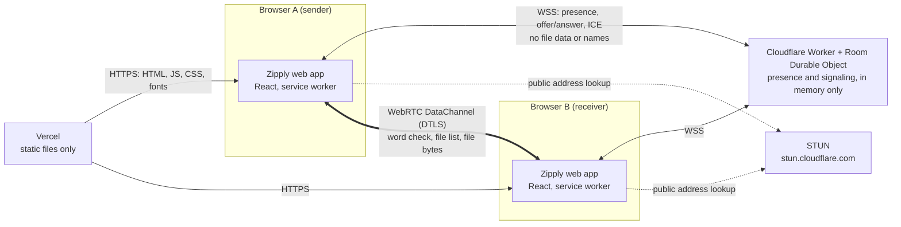

# Zipply — Architecture

Zipply is a static website plus a small signaling service. The service introduces two browsers to each other; the files then go directly between the browsers. Message formats are in `docs/PROTOCOL.md`, and the security reasoning in `docs/SECURITY_DECISIONS.md`.

## Components

| Part                | Where                                   | Does                                                                                                                                                        | Does not                                                                       |
| ------------------- | --------------------------------------- | ----------------------------------------------------------------------------------------------------------------------------------------------------------- | ------------------------------------------------------------------------------ |
| Website             | `apps/web`, served by Vercel            | UI, WebRTC, the word check, chunking, hashing, saving received files, offline shell                                                                         | talk to any server other than its own origin, the signaling service and STUN   |
| Signaling service   | `apps/signaling` (Worker + `Room`)      | admits a WebSocket by path, Origin and `hello`; keeps presence per scope in socket attachments; routes requests, offers, answers and ICE inside a pair only | store anything (no SQL, KV or storage calls, lint-enforced), see file metadata |
| Shared protocol     | `packages/protocol`                     | signaling message types and strict validators, used by both apps                                                                                            | import browser or Worker code (lint-enforced)                                  |
| STUN                | Cloudflare                              | tells a browser its public address                                                                                                                          | relay data (there is no TURN)                                                  |
| Manual pairing path | the people themselves (text or QR code) | carries the same offer and answer as the signaling service would, when there is no internet                                                                 | authenticate anything (the word check still does that)                         |

## Connection flow (online)

1. Both pages open a WSS connection to the signaling service and send `hello` (display name, discoverable or not, optional private-room capability). The service answers with a random peer id and the list of discoverable peers in that scope.
2. A asks to connect to B (`connection-request`, no file information). B accepts or rejects.
3. A sends an offer with a commitment `cO`; B answers with a nonce `nA`; ICE candidates follow. The service only forwards these between A and B.
4. The DataChannel opens. A reveals its nonce, both pages compute the same six words from the DTLS fingerprints and nonces (SD-02), and each person reads three words aloud and types the other three. A mismatch, three wrong tries or a cancel closes the connection.
5. Only after both checks pass does A send the file list. B accepts or rejects the files.
6. After B accepts, A sends the files in 64 KiB chunks (the default; the protocol allows 1–256 KiB), pausing whenever the DataChannel's buffer passes its high watermark. Each chunk carries its SHA-256; B checks it before writing, checks the file's root digest at the end, writes the file to its sink, reads the stored copy back and checks it again, then saves it as a download (SD-06).

If the connection drops, the offerer first restarts ICE on the same connection; if that fails, the transfer pauses and can continue on a new, freshly verified connection from the receiver's last confirmed position (SD-07). Nothing survives a page reload (D22).

Offline, steps 1–3 are replaced by two codes the people carry between the devices (`docs/OFFLINE-MODE.md`); steps 4–6 are identical.

## Code layout

- `apps/web/src/features/` — `radar` (radar and people list), `presence` (signaling client, names, private rooms), `connection` (`RTCPeerConnection`, the SAS and gate state machine, the session protocol), `transfer` (frames, sender, receiver, sinks, transfer UI), `pairing` (manual codes, QR), `settings` (theme, service-worker updates).
- `apps/web/src/ui/` — shared components, styles and self-hosted fonts.
- `apps/web/sw.js` — the service worker; the build writes the precache list into `dist/sw.js`.
- `apps/signaling/src/` — `index.ts` (HTTP routing, Origin and HTTPS checks) and `room.ts` (the Durable Object).
- `e2e/` — Playwright tests, including the MITM, consent, resume, large-file, offline and pairing suites.
- `scripts/performance/` — the bundle budget, Lighthouse and PageSpeed scripts (`docs/PERFORMANCE.md`).

## Boundaries enforced by tooling

- Browser code and Worker code never import each other; only `@zipply/protocol` is shared (ESLint `no-restricted-imports`).
- Raw HTML sinks, `eval` and `new Function` are lint errors; shipped code cannot log (`no-console`).
- The Durable Object cannot call storage APIs other than the alarm timer (ESLint rule, SD-10).
- A production build fails if the signaling URL is `ws://` to anything but localhost.
